# payCcount — 日本産オンラインEウォレット（デモ）

> **これはデモアプリケーションです。** 実際の資金・暗号資産・カード情報は扱いません。外部決済・為替・ブロックチェーン連携はすべてモックです。法規制対応はスコープ外です。

payCcount は「クレジット決済・QR 決済に続く **第 3 の国内決済手段**」という構想を、動くプロトタイプとして示すものです。1 つのアプリで次を提供します。

| 機能 | 内容 |
|---|---|
| JPY ウォレット | 模擬カードチャージ、模擬銀行振込（**入金通知 → 照合 → 冪等 → 仕訳 → 通知** の実務フロー）、残高、統合取引履歴 |
| マルチカレンシー | JPY / USD / EUR / GBP の保有と両替（Quote 60 秒 → Execute、スプレッド 0.5%） |
| クリプト | BTC / ETH の売買（模擬カストディ、スプレッド 1%）、模擬入金アドレス、模擬出金（fake tx hash） |
| ポイント | 1 PT = 1 JPY。カード / 銀行振込 / JPY 残高で購入、キャンペーンボーナス、決済にのみ使用可 |
| EC 決済 API | Stripe 風の `/v1` API・`@payccount/js` SDK・Checkout ページ・署名付き Webhook（指数バックオフで再送） |
| 決済ブランド | 加盟店ダッシュボード（APIキー、Webhook、イベントログ、返金、精算残高）、管理者（運営）画面 |

内部台帳は**複式簿記**です。どの操作の後も「全仕訳の通貨別合計 = 0」「ユーザー・加盟店口座の残高 ≥ 0」「口座残高と仕訳行の集計が一致」が成り立ち、`pnpm ledger:verify` で検証できます。

## スクリーンショット

| ウォレット | 銀行振込チャージ | 両替 |
|---|---|---|
| 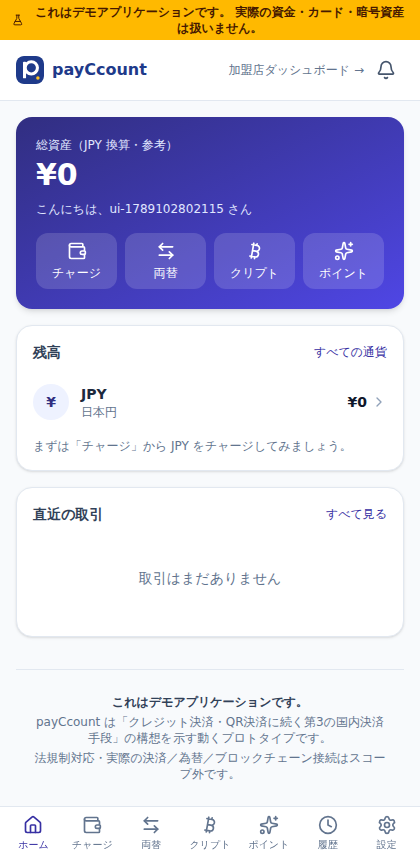 | 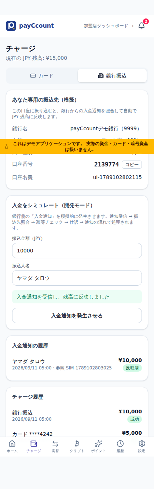 | 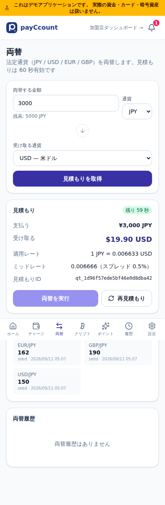 |

| クリプト | ポイント | Checkout（海外EC・BTC 払い） |
|---|---|---|
| 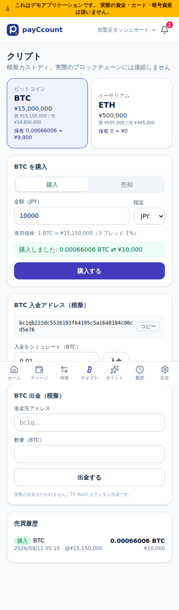 | 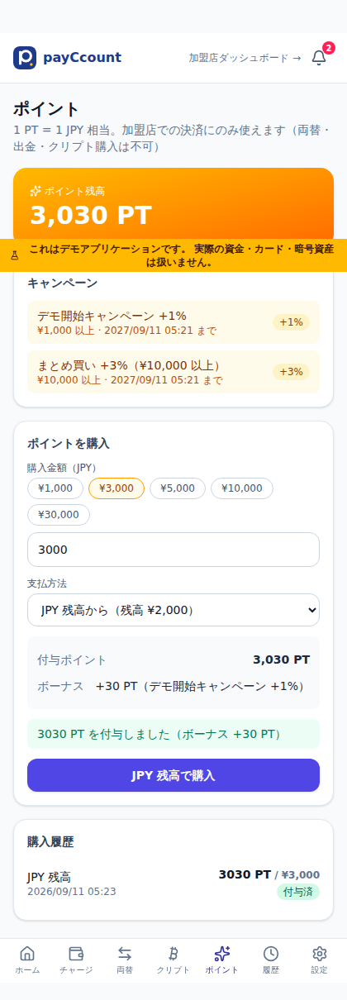 | 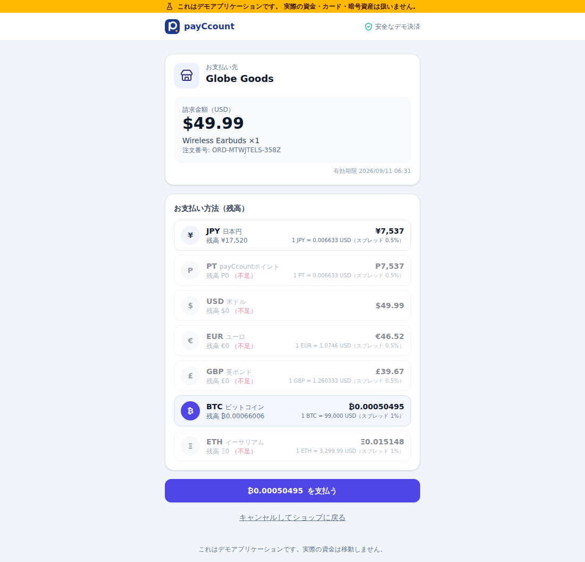 |

| 加盟店ダッシュボード | Webhook イベントログ | サンプルEC（Webhook 受信） |
|---|---|---|
| 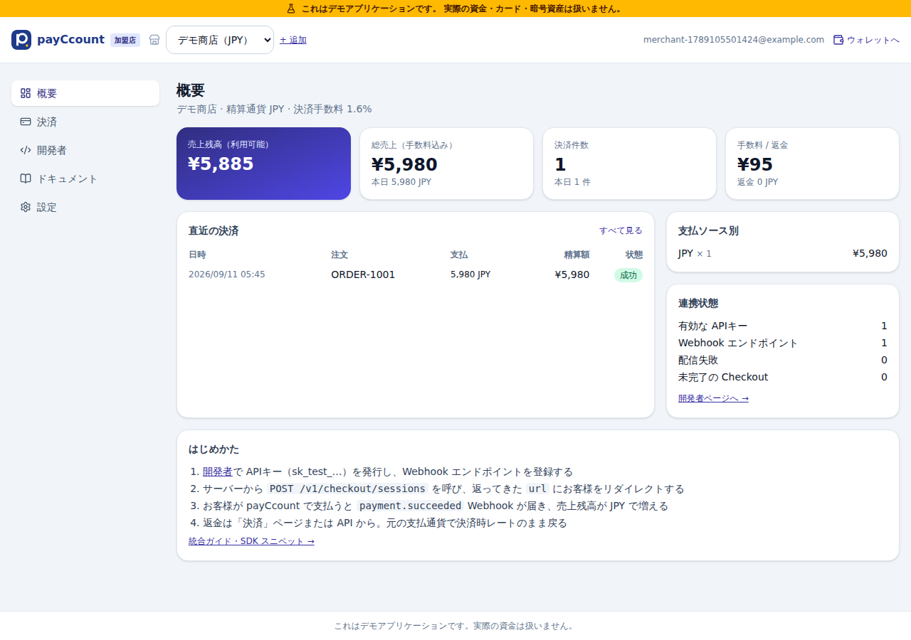 | 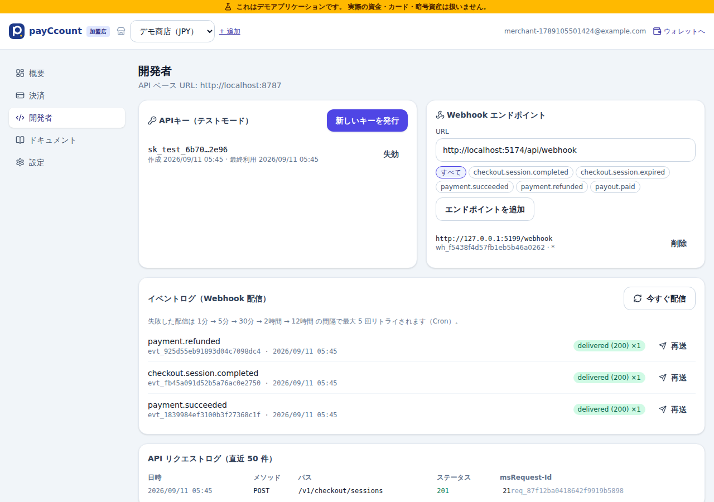 | 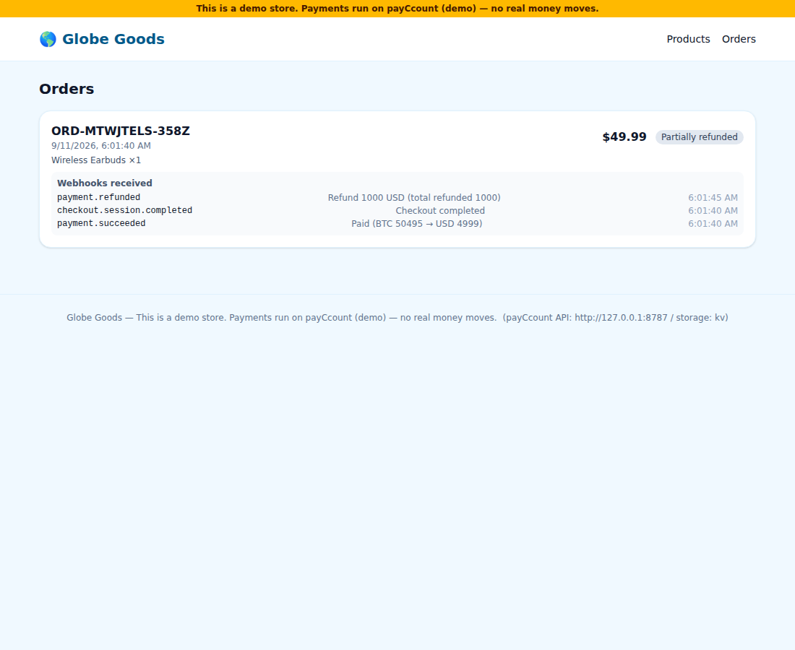 |

| 管理者: 運営ダッシュボード | 管理者: 台帳（仕訳ブラウザ） |
|---|---|
| 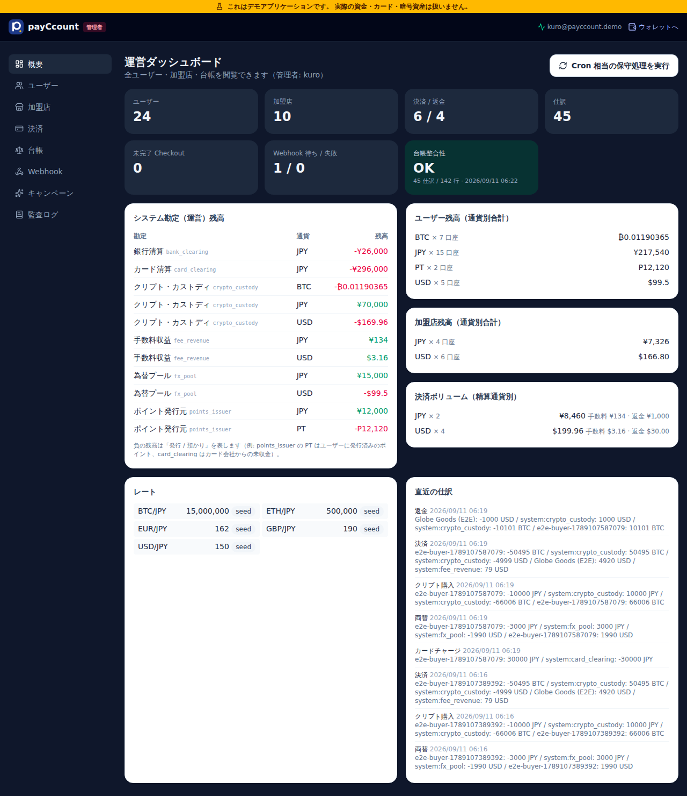 | 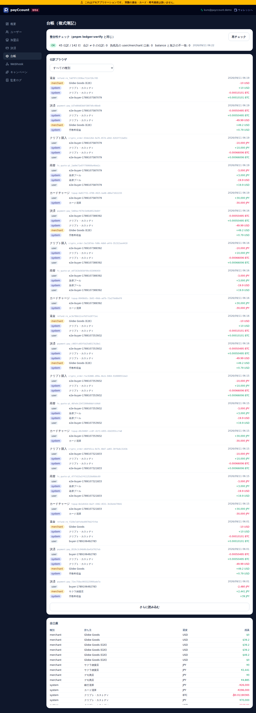 |

## アーキテクチャ

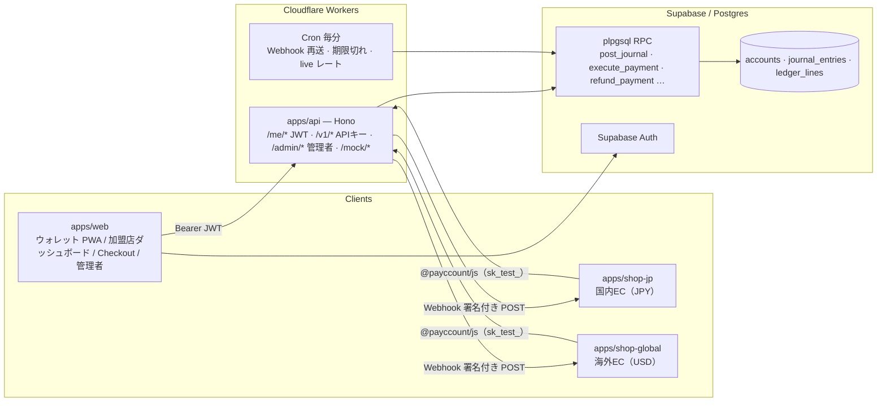

- **金額**は最小単位の整数（DB `numeric(40,0)`、API では文字列）。ETH の wei も Number に落とさない
- **残高変更はすべて `post_journal` RPC 経由**。API 層は残高を直接 UPDATE しない。業務処理（決済・返金・両替…）は 1 回の RPC で 1 トランザクション
- 為替はミッドレート × (1 − スプレッド)。差額は `fx_pool` / `crypto_custody` 勘定に残る。返金は元の支払通貨で決済時の按分
- 詳細は [docs/architecture.md](docs/architecture.md)、API は [docs/api.md](docs/api.md)、仕様とフェーズ計画・決定事項は [CLAUDE.md](CLAUDE.md)

## リポジトリ構成

```
apps/api          Hono / Cloudflare Workers（内部API・加盟店向け公開API・Webhook 配信・Cron）
apps/web          React + Vite + PWA（ウォレット / 加盟店ダッシュボード / Checkout / 管理者）
apps/shop-jp      サンプル国内EC（JPY）— Pages Functions で Session 作成・Webhook 受信
apps/shop-global  サンプル海外EC（USD・英語）
packages/shared   型・通貨ユーティリティ（formatAmount / parseAmount）・Webhook 署名
packages/sdk      @payccount/js（加盟店向け SDK）
supabase/         migrations（スキーマ・RPC）・seed.sql（管理者 kuro）
scripts/          ローカル Postgres 起動・台帳検証
e2e/              Playwright E2E
```

## クイックスタート（Supabase 不要・ローカル Postgres）

前提: Node 20+、pnpm 10、PostgreSQL 15+（`initdb` / `pg_ctl` が使えること）。

```bash
pnpm install
pnpm db:start                      # ローカル Postgres を初期化・起動し、マイグレーションとシードを適用
cp apps/api/.dev.vars.example apps/api/.dev.vars
pnpm dev                           # API http://localhost:8787 + ウォレット http://localhost:5173
```

- ウォレット: http://localhost:5173 — デモ認証なのでメールアドレスを入れるだけでログインできます
- 管理者: ログイン画面「管理者」タブ → ID `kuro` / パスワード `atusi0130` → http://localhost:5173/admin
- 加盟店: 右上「加盟店ダッシュボード」→ 店舗登録 → 開発者で APIキー・Webhook を発行
- サンプルEC: [apps/shop-jp/README.md](apps/shop-jp/README.md) / [apps/shop-global/README.md](apps/shop-global/README.md) の手順で `.dev.vars` を設定し `pnpm dev:shop-jp` / `pnpm dev:shop-global`

テスト用の値: カード `4242424242424242`（成功）/ `4000000000000002`（失敗）、レートは USD/JPY 150・BTC/JPY 15,000,000 など（`/mock/rates/set` で変更可）。

### デモの見せ方（おすすめの流れ）

1. **チャージ**（/topup）: カードで ¥30,000。銀行振込タブで振込先を確認し「入金通知を発生させる」→ 通知ベルに「入金を確認しました」
2. **両替**（/exchange）: JPY 3,000 → USD、60 秒の見積もりと残り秒数
3. **クリプト**（/crypto）: ¥10,000 分の BTC を購入、入金シミュレート、出金で fake tx hash
4. **ポイント**（/points）: JPY 残高で 3,000 PT（+1%）、銀行振込で識別コード付き入金 → 付与
5. **海外EC**（shop-global）: Earbuds $49.99 を **BTC で支払う** → 加盟店残高が USD で増え、`fee_revenue` と `crypto_custody` に差額
6. **返金**（加盟店ダッシュボード → 決済）: $10 返金 → ユーザーに BTC が決済時レートの按分で戻る、`payment.refunded` Webhook
7. **管理者**（/admin）: システム勘定の残高、台帳整合性 OK、全仕訳の閲覧

## テスト

```bash
pnpm test               # shared（金額ユーティリティ）/ sdk / api（実 DB に対して台帳・API 108 件）
pnpm typecheck
pnpm ledger:verify      # 台帳整合性（DATABASE_URL で対象 DB を指定可）
pnpm e2e                # Playwright: チャージ → 両替 → 海外ECで BTC 払い → 返金（サーバーは自動起動）
```

API テストはローカル Postgres の `payccount_test` を作り直して実行します（`pnpm db:start` が必要）。E2E はブラウザを別パスから使う場合 `PW_CHROMIUM=/path/to/chromium pnpm e2e`。

## Supabase を使う場合

1. Supabase プロジェクトを作成し、`supabase/migrations/*.sql` を順に適用（`supabase db push` または SQL エディタ）。続けて `supabase/seed.sql`（管理者 `kuro@payccount.demo` / `atusi0130` を `auth.users` に作成）
2. Authentication → Email で OTP（メール）を有効化
3. `apps/api/.dev.vars`（本番は `wrangler secret put`）:
   ```
   SUPABASE_URL=https://xxxx.supabase.co
   SUPABASE_SERVICE_ROLE_KEY=...
   AUTH_MODE=supabase
   JWT_SECRET=<Supabase の JWT Secret。未設定なら JWKS で検証>
   APP_URL=https://<pages の URL>
   ALLOWED_ORIGINS=https://<pages の URL>,https://<shop の URL>
   DEMO_MOCK_ENDPOINTS=true
   RATES_PROVIDER=mock   # live にすると Frankfurter / CoinGecko を 5 分ごとに取得
   ```
4. `apps/web/.env.local`:
   ```
   VITE_API_URL=https://<workers の URL>
   VITE_SUPABASE_URL=https://xxxx.supabase.co
   VITE_SUPABASE_ANON_KEY=...
   ```

## デプロイ（無料枠）

| 対象 | 手順 |
|---|---|
| API（Workers） | `cd apps/api && wrangler deploy`。`[triggers] crons = ["* * * * *"]` で Webhook 再送・期限切れ処理・live レート取得が動く。秘密は `wrangler secret put SUPABASE_SERVICE_ROLE_KEY` など |
| ウォレット（Pages） | `cd apps/web && pnpm build && wrangler pages deploy dist --project-name payccount-web`。SPA なので `dist/_redirects` に `/* /index.html 200` を置くか、Pages の設定で SPA フォールバックを有効化 |
| サンプルEC（Pages） | 各 README 参照。KV `ORDERS` を作成し `wrangler.toml` に ID を設定、環境変数に APIキーと Webhook シークレット |
| DB | Supabase（無料枠）。ローカル Postgres で動かす場合は `DATABASE_URL` を Workers から到達できる接続（Hyperdrive 等）にする |

## 主要な設計判断

- **DB アクセスは RPC 呼び出しのみ**の `Db` ポート。Supabase（PostgREST）アダプタとローカル Postgres（postgres.js）アダプタの 2 実装で、Supabase なしでも全機能とテストが動く
- **認証**は `AUTH_MODE=supabase`（Supabase Auth JWT）/ `demo`（メールだけでログイン）を切替可能。フロントも `VITE_SUPABASE_URL` の有無で自動切替
- **業務エラー**は plpgsql の `raise exception`（message = コード、detail = 日本語メッセージ）を API 層で Stripe 風 `{ error: { type, code, message, param } }` に変換。`insufficient_funds` は 402
- **Webhook** はエンドポイントごとの配信レコードを持ち、`skip locked` で多重実行に耐えるワーカー、`1分 → 5分 → 30分 → 2時間 → 12時間` の最大 5 回リトライ、ダッシュボードから再送
- その他は [CLAUDE.md](CLAUDE.md) の「決定事項ログ」を参照

## ライセンス / 注意

デモ用途のサンプルコードです。管理者アカウント（`kuro` / `atusi0130`）を含む固定値はデモ専用で、実運用では必ず変更してください。
