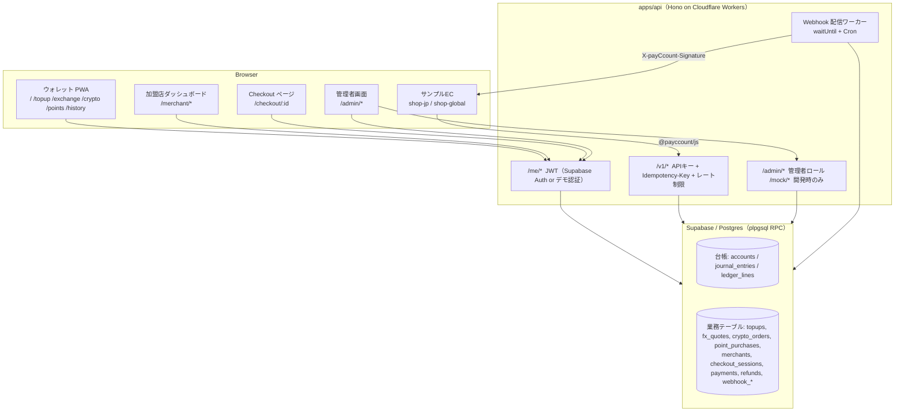
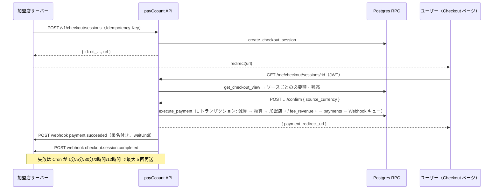

# payCcount アーキテクチャ

> デモアプリケーション。実際の資金は扱わない。

## 1. 全体像

## 2. 台帳（複式簿記）

- **口座（accounts）**: `owner_type ∈ {user, merchant, system}` × 通貨で 1 口座。システム勘定は `fx_pool`（為替プール）、`crypto_custody`（クリプト・カストディ）、`points_issuer`（ポイント発行元）、`fee_revenue`（手数料収益）、`card_clearing`（カード清算）、`bank_clearing`（銀行清算）
- **仕訳（journal_entries + ledger_lines）**: すべての残高変動は `post_journal()` を通す。`amount` は符号付きの「その口座の増減」。同一 journal・同一通貨の合計は 0
- **不変条件**（`ledger_verify()` / `pnpm ledger:verify`）
  1. 全仕訳の通貨別合計 = 0
  2. user / merchant 口座の残高 ≥ 0（違反時は `insufficient_funds` でロールバック）
  3. `accounts.balance`（キャッシュ）と `ledger_lines` の集計が一致
- **冪等**: `journal_entries.idempotency_key` が一意。同じキーは既存の journal を返す（同時実行は unique 制約で直列化）
- **ロック**: 対象口座を ID 順に `for update` してデッドロックを避ける

### 代表的な仕訳

| 操作 | 行 |
|---|---|
| カードチャージ ¥1,000 | user JPY +1000 / card_clearing JPY −1000 |
| 銀行振込 ¥30,000 | user JPY +30000 / bank_clearing JPY −30000 |
| 両替 ¥15,000 → $99.50 | user JPY −15000 / fx_pool JPY +15000 / fx_pool USD −9950 / user USD +9950（スプレッド分は fx_pool に残る） |
| BTC 購入 ¥15,150 | user JPY −15150 / crypto_custody JPY +15150 / crypto_custody BTC −100000 / user BTC +100000 |
| ポイント購入 ¥3,000（+1%） | user JPY −3000 / points_issuer JPY +3000 / points_issuer PT −3030 / user PT +3030 |
| 決済 JPY→JPY ¥5,980 | user JPY −5980 / merchant JPY +5885 / fee_revenue JPY +95 |
| 決済 BTC→USD $49.99 | user BTC −50495 / crypto_custody BTC +50495 / crypto_custody USD −4999 / merchant USD +4920 / fee_revenue USD +79 |
| 決済 PT→USD | user PT − / points_issuer PT + / points_issuer JPY − / fx_pool JPY + / fx_pool USD − / merchant USD + / fee_revenue USD + |
| 返金 $10（BTC 払い） | merchant USD −1000 / crypto_custody USD +1000 / crypto_custody BTC −10101 / user BTC +10101 |

## 3. 金額とレート

- 金額は**最小単位の整数**。DB `numeric(40,0)`、API/JSON は文字列、フロントは `bigint`（`packages/shared` の `formatAmount` / `parseAmount`）
- レートは `rates(base, quote, rate numeric(30,12))` に **X/JPY** で保存。逆数・クロスは `get_rate()` が計算。PT は JPY と等価
- 換算は DB の `convert_minor*()` が `div()`（整数除算）で行い、wei（18 桁）でも丸め誤差を出さない。ユーザーが支払う側の必要額は切り上げ、受け取る側は切り捨て
- スプレッド: 為替 0.5%、クリプト 1.0%（`config` テーブル）。実効レート = ミッド × (1 ∓ spread)

## 4. 決済フロー（Checkout）

## 5. 加盟店 API のミドルウェア

1. `requireApiKey`: `sk_test_…` の SHA-256 で `api_keys` を照合、失効チェック、`bump_rate_limit`（60 req/分・固定ウィンドウ・DB カウンタ）、リクエストログを非同期保存
2. `idempotency`: POST は `Idempotency-Key` 必須。`(merchant_id, key)` で保存済みレスポンスを再送（`Idempotency-Replayed: true`）、ボディのハッシュが違えば 409。`create_checkout_session` 側でも `(merchant_id, idempotency_key)` を一意にして二重防御
3. ハンドラ → RPC → JSON。エラーは `DbError`（message = コード）→ `ApiError`（HTTP + Stripe 風本文）

## 6. Webhook の信頼性

- `webhook_events`（加盟店単位のイベント）と `webhook_deliveries`（エンドポイントごとの配信）を分離
- `claim_webhook_deliveries()` が `for update skip locked` で期限の来た配信を `in_flight` にし、ワーカーが送信、`record_webhook_delivery()` が結果（HTTP コード・本文先頭 1KB・エラー）と次回時刻を記録
- 取り残された `in_flight` は 5 分後に `pending` へ戻す。ダッシュボード / API から再送（新しい配信レコードを作り履歴を残す）
- 署名: `X-payCcount-Signature: t=<unix>,v1=<hex(HMAC-SHA256(secret, t + "." + body))>`。SDK の `constructEvent` が検証（許容ずれ 300 秒）

## 7. 認証

| モード | ユーザー | 管理者 | API 側の検証 |
|---|---|---|---|
| `supabase` | Supabase Auth メール OTP | `kuro@payccount.demo` + パスワード（seed で auth.users に作成） | `JWT_SECRET`（HS256）または JWKS |
| `demo`（ローカル） | メールアドレスだけでログイン（`demo_upsert_user`） | `admin_credentials`（bcrypt）で ID/パスワード | `JWT_SECRET`（HS256） |

API は service role で DB に接続し、認可（本人・加盟店オーナー・管理者）は RPC / ミドルウェアで行う。テーブルには RLS を有効化し、anon / authenticated への RPC 実行権は与えない。

## 8. ローカル開発とテスト

- `scripts/db/local.sh` がローカル Postgres クラスタ（port 54329）を初期化し、`auth` スタブ → `supabase/migrations/*.sql` → `seed.sql` を適用
- `apps/api` のテストは `payccount_test` を作り直し、実 DB に対して Hono アプリを `app.request()` で叩く（Webhook 先は偽 fetch）
- Workers では postgres.js の接続をリクエストごとに作って閉じる（TCP ソケットをリクエスト間で共有できないため）。Supabase アダプタは共有
- E2E（Playwright）は API / ウォレット / shop-global を自動起動し、チャージ → 両替 → BTC 払い → 返金 → 台帳検証を通す
