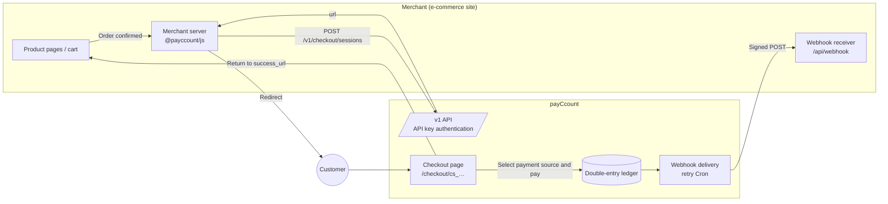
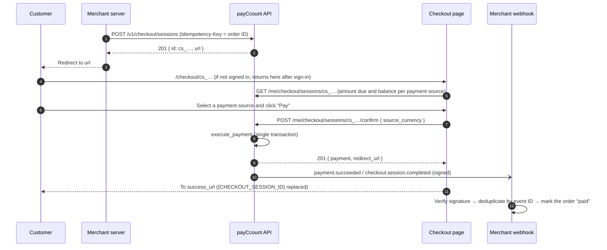
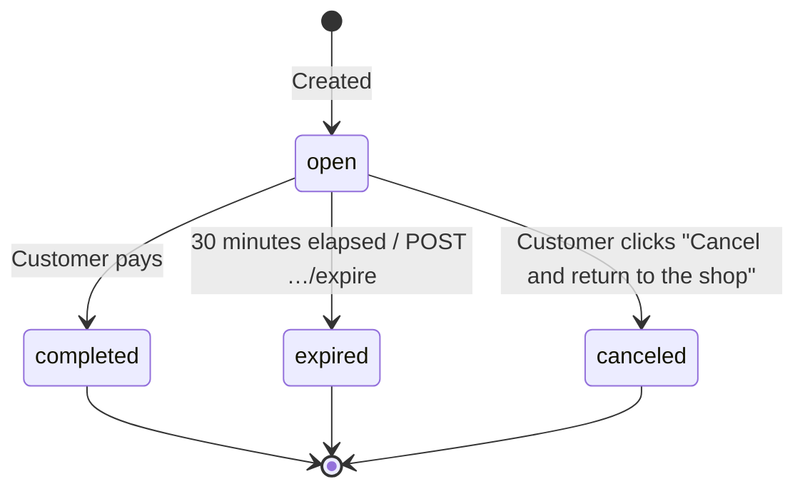
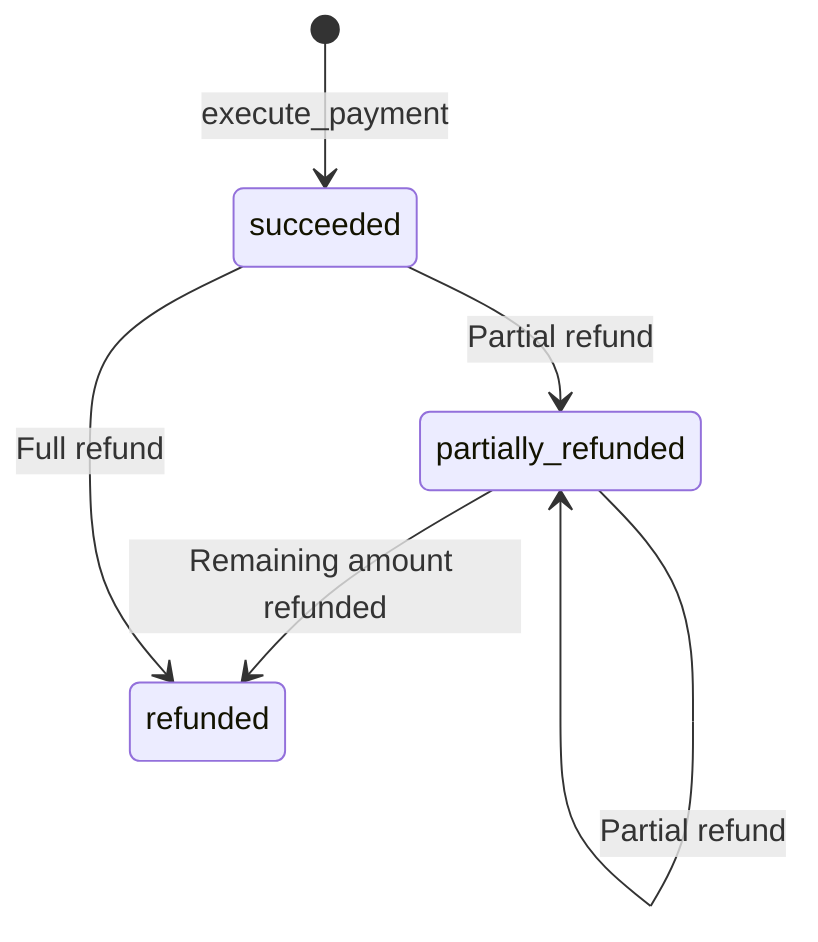

<!-- English version of docs/specs/merchant.ja.md — keep both files in sync -->
# payCcount Merchant Payment Integration Specification (for E-commerce Sites)

| Item | Details |
|---|---|
| Audience | Developers and operations staff of e-commerce sites (domestic and international) that integrate payCcount as a payment method |
| Version | 1.0 (2026-09-12) |
| Scope | This document defines the integration specification (business rules, flows, and division of responsibilities). For the inputs and outputs of each individual endpoint, the [API Reference](../api.en.md) is authoritative |
| Premise | payCcount is a **demo application** and does not handle real funds, card details, or crypto assets. All external payment, FX, and blockchain integrations are simulated |

---

## 1. Overview

payCcount is a **global e-wallet service** that lets a single account hold fiat currencies (JPY / USD / EUR / GBP), crypto assets (BTC / ETH) and points, and a payment brand that spends those balances directly at e-commerce sites at home and abroad. Merchants integrate through a Stripe-style REST API and a JS SDK (`@payccount/js`), and can complete the following end-to-end sequence entirely through the API.

```
Issue API key → Create Checkout Session → Customer pays → Receive webhook → Sales balance credited → Refund
```

From the merchant's point of view, the key characteristics are as follows.

- **One settlement currency per merchant** (JPY / USD / EUR / GBP). Whether the customer pays in JPY, points, foreign currency, BTC, or ETH, the merchant is credited in its settlement currency. FX differences and spreads are borne by payCcount (the operator).
- **A payment is finalized in a single transaction.** Debiting the user's balance, converting the currency, crediting the merchant's balance, and booking the fee all take effect simultaneously as a single double-entry journal entry; there is no intermediate state.
- **Webhooks are signed and retried.** A failed delivery is retried up to 5 times with exponential backoff, and can be resent manually from the dashboard.

## 2. Terminology

| Term | Meaning |
|---|---|
| Merchant | An e-commerce business that accepts payments through payCcount. Has a `merchant_id` |
| Owner | The wallet user who registered the merchant. Can operate the dashboard |
| Settlement currency | The currency in which the merchant receives its sales. Chosen at registration; cannot be changed once the merchant has any payments |
| Payment source | The currency of the balance the customer pays with. JPY / PT / USD / EUR / GBP / BTC / ETH |
| Checkout Session | A single payment request. Has an ID starting with `cs_` and expires after 30 minutes |
| Payment | A finalized payment. `pay_` |
| Refund | A refund. `re_`. Multiple partial refunds are allowed |
| Webhook endpoint | A URL that receives event notifications. `wh_`. Has a signing secret `whsec_` |
| Event | `evt_`. Emitted once per merchant and delivered to each endpoint individually (`whd_`) |
| Minor units | The representation of amounts. Yen for JPY, cents for USD/EUR/GBP, satoshi for BTC, wei for ETH, points for PT. Always a **string** in the API |

## 3. Overall Architecture



### 3.1 Division of responsibilities

| Responsibility | Merchant | payCcount |
|---|---|---|
| Deciding products and amounts | ○ (**always recalculate on the server side**) | — |
| Creating the Checkout Session | ○ | Validation, storage, URL issuance |
| Customer authentication, balances, conversion, and finalizing the payment | — | ○ |
| Notifying the payment result | Receive webhooks and verify the signature | Deliver signed events and retry |
| Updating the order status (paid / refunded) | ○ (deduplicate by event ID) | — |
| Instructing refunds | ○ (API or dashboard) | Prorated refund in the original currency and journal posting |
| Holding the sales balance | — | ○ (settlement currency) |

## 4. Merchant Registration and Account

1. Sign in to the wallet, open "Merchant dashboard", and register a store (store name, country, settlement currency, site URL).
2. One owner can have multiple stores (for example, a domestic store in JPY and an international store in USD).
3. The merchant fee at registration is **1.6%** (`fee_bps = 160`), the same for all stores.
4. The settlement currency cannot be changed once the store has even one payment (`settlement_currency_locked`).
5. The operator (administrator) can also create a merchant from the admin console and issue its first API key.

## 5. Credentials

### 5.1 API keys

| Item | Specification |
|---|---|
| Format | `sk_test_` + 48 hexadecimal digits (test mode only) |
| Issuance | Dashboard "Developers" → "Create new key". **The plaintext key is shown only once, at issuance** |
| Storage | The server stores only the SHA-256 hash. It keeps a display prefix `sk_test_xxxx…xxxx` and the last-used timestamp |
| Revocation | Revoked immediately from the dashboard. After revocation, requests return `401 invalid_api_key` |
| Usage | `Authorization: Bearer sk_test_…`. **Never embed it in a browser** (use it only on the server side) |
| Multiple keys | Several keys can be active at the same time (for rotation) |

### 5.2 Webhook secret

When you register an endpoint, `whsec_` + 48 hexadecimal digits is returned **only at creation**. If you lose it, delete the endpoint and create it again.

## 6. Payment Flow (Checkout Session)

### 6.1 Sequence



### 6.2 Rules when creating a Session

| Item | Rule |
|---|---|
| `amount` / `currency` | Minor units of the settlement currency. `currency` must **match the merchant's settlement currency** (a mismatch returns `400 currency_not_supported`) |
| `order_id` | Optional but strongly recommended. Using the same value as the `Idempotency-Key` prevents duplicate creation |
| `description` | Optional. Shown on the Checkout page and in the descriptions of the payment and refunds |
| `success_url` / `cancel_url` | Required. `http(s)://`. `{CHECKOUT_SESSION_ID}` in `success_url` is replaced with the Session ID |
| `accepted_sources` | Array of payment sources the customer may use. All currencies when omitted |
| `metadata` | Any JSON object. Included as-is in the webhook's `data.object.metadata` |
| Expiry | **30 minutes** from creation. The Cron marks expired Sessions `expired` and emits `checkout.session.expired` |
| URL | `{{APP_URL}}/checkout/{session_id}`. Can be opened any number of times while it is valid |

### 6.3 Session states



A payment against a Session that is not `open` returns `400 session_not_open` (`410 session_expired` if it has expired). The same Session is never finalized twice (one payment per Session, idempotent).

### 6.4 Payment sources and conversion

The customer's Checkout page shows the "amount due" for each payment source. The amount due is determined as follows (`compute_source_amount` in the DB).

| Case | Amount due |
|---|---|
| Payment source = settlement currency | `amount` as-is |
| PT, with JPY as the settlement currency | `amount` as-is (1 PT = 1 JPY) |
| Otherwise (different currency) | `ceil(amount ÷ rate)`, where `rate = mid rate × (1 − spread)` |

- Spread: fiat **0.5%** (`fx_spread_bps = 50`), BTC / ETH **1.0%** (`crypto_spread_bps = 100`). PT is treated as JPY.
- The effective rate at payment time `fx_rate` (1 source = fx_rate settlement), together with `mid_rate` and `spread_bps`, is stored on the Payment and used to prorate refunds.
- The conversion difference remains in the operator's `fx_pool` / `crypto_custody` accounts. The merchant always receives `amount` (in the settlement currency).
- In the demo, rates are fixed values (USD/JPY 150, EUR/JPY 162, GBP/JPY 190, BTC/JPY 15,000,000, ETH/JPY 500,000). Operator settings may switch them to external rates (refreshed every 5 minutes).

### 6.5 Ledger at payment finalization (reference)

`execute_payment` performs the following in a single transaction.

1. Debit the customer's account (payment source currency) by the amount due (if the balance is insufficient, `402 insufficient_funds` and nothing is finalized)
2. If the currency differs, convert to the settlement currency via `fx_pool` / `crypto_custody` (`points_issuer` for PT)
3. Credit `amount − fee` to the merchant account (settlement currency) and `fee` to `fee_revenue`
4. Create the `payments` row and mark the Session `completed`
5. Enqueue `payment.succeeded` and `checkout.session.completed`

Example: paying $49.99 in BTC to Globe Goods (USD settlement), with a BTC/USD mid rate of 100,000 and a 1% spread.

| Account | Currency | Change |
|---|---|---|
| Customer | BTC | −50,495 sat |
| crypto_custody | BTC | +50,495 sat |
| crypto_custody | USD | −4,999 |
| Globe Goods | USD | +4,920 |
| fee_revenue | USD | +79 |

## 7. Fees and Settlement (Sales Balance)

| Item | Specification |
|---|---|
| Merchant fee | Settlement amount × **1.6%** (rounded down in minor units). `payment.fee_amount` |
| Merchant net amount | `net_amount = settlement_amount − fee_amount`. This amount is credited to the sales balance |
| Sales balance | `available` in `GET /v1/balance` (settlement currency). `pending` is always empty in the demo |
| Balance transactions | `GET /v1/balance/transactions`. Returns the ledger lines (`payment` / `refund` / `payout`) |
| Payout | **Not implemented** (P1). The sales balance can be viewed in the dashboard and via the API, but no transfer to a bank account is made |

## 8. Refunds

| Item | Specification |
|---|---|
| Instruction | `POST /v1/payments/:id/refunds` (`Idempotency-Key` required) or the dashboard "Payments" |
| Amount | Minor units of the settlement currency. Omit to refund the full remaining amount. Multiple partial refunds are allowed |
| Limit | `400 refund_exceeds_payment` if the cumulative total exceeds `settlement_amount` |
| Return to the customer | In the **original payment source currency**. `floor(source_amount × amount ÷ settlement_amount)`. The final full refund returns everything that remains, so after a full refund the balance equals the balance before the payment |
| FX | Returned at the **`fx_rate` at payment time**, not the rate at refund time. The difference is absorbed by the operator's pool accounts |
| Fee | Not refunded (operator setting `refund_returns_fee = false`) |
| Funding | Deducted from the merchant's sales balance. If it is insufficient, `402 insufficient_funds` |
| Notification | `payment.refunded` (`data.object` is the Payment and includes the `refund` object) |
| Status | `succeeded → partially_refunded → refunded` |

## 9. Webhooks

### 9.1 Endpoints

| Item | Specification |
|---|---|
| Registration | `POST /v1/webhook_endpoints { url, events? }` or the dashboard. **Up to 10** per merchant |
| `events` | Array of event types to subscribe to. Omit it or pass `["*"]` for all types |
| URL | `http(s)://`. Use HTTPS in anything resembling production |
| Deletion | `DELETE /v1/webhook_endpoints/:id`. No further deliveries are made |

### 9.2 Event types

| type | When | `data.object` |
|---|---|---|
| `checkout.session.completed` | The customer completed the payment | Checkout Session |
| `checkout.session.expired` | Expired / the expire API was called | Checkout Session |
| `payment.succeeded` | The payment succeeded (at the same time the Session completes) | Payment |
| `payment.refunded` | A refund (partial or full) | Payment (includes `refund`) |
| `payout.paid` | Payout (P1, not implemented) | Payout |

`payment.succeeded` and `checkout.session.completed` arrive **at the same time**. Their order is not guaranteed. We recommend treating `payment.succeeded` as the source of truth for updating the order status and `checkout.session.completed` as a record only.

### 9.3 Payload and signature

```json
{ "id": "evt_…", "type": "payment.succeeded", "created": 1735689600, "demo": true,
  "data": { "object": { "id": "pay_…", "order_id": "ORDER-1001", "…": "…" } } }
```

```
X-payCcount-Signature: t=<unix seconds>,v1=<hex(HMAC-SHA256(secret, t + "." + rawBody))>
```

Verification procedure on the receiving side:

1. Split the header into `t` and `v1`
2. Reject if `|now − t| > 300 seconds` (replay protection)
3. Compute `HMAC-SHA256(secret, t + "." + the raw body as received)` as hex and compare it with `v1` using a **constant-time comparison**
4. Parse the JSON only if they match. Never verify after pretty-printing or re-serializing the body

SDK: `constructEvent(rawBody, signatureHeader, secret, toleranceSec = 300)` (`@payccount/js/webhooks`) performs the steps above and throws `WebhookSignatureError` on a mismatch.

### 9.4 Delivery and retries

| Item | Specification |
|---|---|
| Initial delivery | Sent asynchronously immediately after the payment |
| Success criteria | HTTP 2xx. Anything else, a timeout (10 seconds), or a connection failure counts as a failure |
| Retries | Up to 5 attempts at intervals of **1 min → 5 min → 30 min → 2 hours → 12 hours** (Cron every minute) |
| Records | The response status code and the first 1 KB of the body are stored per delivery (viewable in the dashboard) |
| Manual resend | Dashboard "Event log" → "Resend", or `POST /v1/events/:id/resend`. A new delivery record is created |
| Stranded deliveries | A delivery left `in_flight` for 5 minutes or more is automatically re-queued |
| Duplicates | The same event may arrive more than once. **Deduplicate by `id` (`evt_…`)** |

After verifying the signature and deduplicating, the receiver should return 2xx as quickly as possible and perform any heavy processing asynchronously.

## 10. Common API Rules

| Item | Specification |
|---|---|
| Idempotency | `Idempotency-Key` is **required** on every `POST` to `/v1` (max 255 characters). Same key + same body → same response (`Idempotency-Replayed: true`). Same key + different body → `409 idempotency_key_reused`. Session creation is additionally protected by the unique constraint on `(merchant_id, idempotency_key)` |
| Rate limiting | **60 requests / minute** per API key (fixed window). Exceeding it returns `429 rate_limited` with `Retry-After` and `X-RateLimit-Limit` / `X-RateLimit-Remaining` |
| Pagination | `?limit=20&starting_after=<id>` → `{ data: [...], has_more }` |
| Amounts | Integers in minor units, as **strings**. Never use floating point |
| Timestamps | ISO 8601 (UTC) |
| Common headers | Every response carries `X-Demo-Mode: true` and `X-Request-Id` (quote it when contacting support) |
| Errors | `{ "error": { "type", "code", "message", "param" } }`. The mapping between HTTP status and `type` / `code` is in [API Reference §2](../api.en.md) |
| Request log | The most recent 50 requests (method, path, status, duration, Request-Id) can be viewed in the dashboard |

## 11. SDK and Integration Patterns

| Form | Usage |
|---|---|
| Server (Node / Workers) | `new PayCcount(secretKey, { baseUrl })` → `checkout.sessions.create / retrieve / expire`, `payments.list / retrieve / refund`, `refunds.retrieve`, `balance.retrieve / transactions.list`, `webhookEndpoints.list / create / del`, `events.list / retrieve / resend`, `webhooks.constructEvent`. For `POST`, an `idempotencyKey` is generated automatically when not specified |
| Webhook receiving | `constructEvent` from `@payccount/js/webhooks` |
| Browser | `redirectToCheckout(sessionId)` / `renderPayButton(container, sessionId, { lang })` from `@payccount/js/browser` |
| Embedded button | `<script src="{{APP_URL}}/sdk/pay.js" data-session="cs_…" data-lang="ja"></script>` (the label can be changed with `data-label`) |
| cURL | See the API Reference |

Reference implementations (in this repository): `apps/shop-jp` (domestic store, JPY) and `apps/shop-global` (international store, USD). They recalculate the amount from the catalog on the server side to create the Session, verify the webhook signature, deduplicate by event ID, and update orders to "paid" / "refunded".

## 12. Merchant Dashboard

| Screen | Features |
|---|---|
| Overview | Sales balance (settlement currency), total sales / count / fees / refunds (today / cumulative), recent payments, breakdown by payment source, integration status (active keys, endpoints, failed deliveries, incomplete Checkouts) |
| Payments | List (filter by status), details (payment currency, applied rate, fee, net, refund history), issuing refunds |
| Developers | Issue / revoke API keys, register / delete webhook endpoints, event log (delivery status, attempts, response, resend, deliver now), API request log |
| Docs | API Reference (Japanese / English) and SDK snippets (Node / cURL / browser) |
| Settings | Store name, country, site URL, settlement currency (locked once there are payments), fee, merchant ID |
| Add store | Registering multiple stores |

The dashboard is available in Japanese and English (JA / EN at the top right).

## 13. Testing and Sandbox

| Item | Value |
|---|---|
| API key | `sk_test_…` (test mode only; there are no live keys) |
| Customer-side top-ups | Test cards `4242424242424242` (success) / `4000000000000002` (failure). For bank transfers, use "Simulate deposit" |
| Rates | Fixed values (§6.4). The operator can change rates during the demo |
| Fee / spread | 1.6% / 0.5% (fiat) / 1.0% (crypto) |
| Webhook connectivity | Dashboard "Deliver now" and "Resend". The response code and body of each delivery can be inspected |
| Sample stores | Start `apps/shop-jp` / `apps/shop-global` and run through Session creation → payment → webhook → refund end to end |

## 14. Security Requirements (Merchant Side)

1. Store the API key as a server-side secret; never put it in a browser or a repository. If it leaks, revoke it immediately and issue a new one.
2. **Always verify the webhook signature**, honoring the `t` tolerance (300 seconds) and constant-time comparison. Do not modify the body before verification.
3. Make webhook processing **idempotent by event ID** (so that it tolerates redelivery and concurrent delivery of the same event).
4. Do not accept amounts from the client; **recalculate them from the server-side catalog** before creating the Session.
5. Use `order_id` as the `Idempotency-Key` so that retries do not create duplicate Sessions.
6. Do not mark an order as paid just because the customer reached `success_url`. Always confirm with `payment.succeeded` or `GET /v1/payments`.
7. Serve the webhook URL over HTTPS and rely on the signature to reject POSTs that do not come from payCcount.

## 15. Limitations (Demo)

- No connection to real fund transfers, card payments, bank APIs, or blockchains.
- API keys exist in test mode only. There is no live-mode distinction, no key permission scopes, and no IP restrictions.
- The payout API and `payout.paid` are not implemented. The sales balance is display-only.
- Customers sign in with an email Magic Link (Supabase Auth) or the demo authentication used for development.
- Exchange rates are demo values. Operator settings can switch them to free external APIs (Frankfurter / CoinGecko), but rate accuracy is not guaranteed.
- The webhook retry schedule and limits, rate limits, and fee rates are operator settings and may change without notice in the demo.

## Appendix A. Payment State Transitions



## Appendix B. Fields of the Main Objects

**Payment**: `id`, `session_id`, `order_id`, `description`, `source_currency`, `source_amount`, `settlement_currency`, `settlement_amount`, `fx_rate`, `mid_rate`, `spread_bps`, `fee_amount`, `fee_bps`, `net_amount`, `status`, `refunded_amount`, `refunded_source_amount`, `refunds[]`, `metadata`, `created_at`

**Refund**: `id`, `payment_id`, `amount`, `currency`, `source_amount`, `source_currency`, `reason` (`requested_by_customer` / `duplicate` / `fraudulent` / `other`), `status`, `created_at`

**Checkout Session**: `id`, `status`, `url`, `amount`, `currency`, `order_id`, `description`, `success_url`, `cancel_url`, `accepted_sources[]`, `metadata`, `payment_id`, `expires_at`, `created_at`, `completed_at`

## Appendix C. Revision History

| Version | Date | Changes |
|---|---|---|
| 1.0 | 2026-09-12 | Initial release (based on the implementation of Phases 5–7) |
