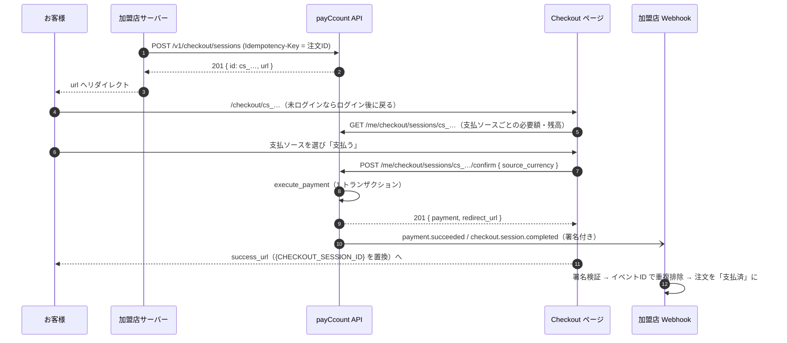
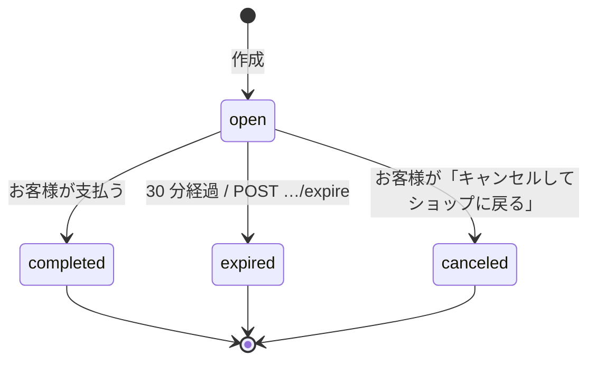
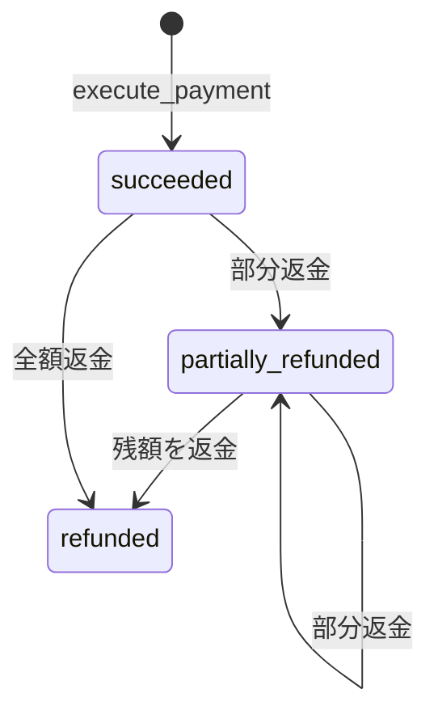

# payCcount 加盟店向け 決済接続仕様書（EC サイト向け）

| 項目 | 内容 |
|---|---|
| 対象読者 | payCcount を決済手段として組み込む EC サイト（国内 / 海外）の開発者・運用担当者 |
| 版 | 1.0（2026-09-12） |
| 位置づけ | 本書は接続の仕様（業務ルール・フロー・責務分担）を定める。個々のエンドポイントの入出力は [API リファレンス](../api.md) を正とする |
| 前提 | payCcount は**デモアプリケーション**であり、実際の資金・カード情報・暗号資産は扱わない。すべての外部決済・為替・ブロックチェーン連携は模擬である |

---

## 1. 概要

payCcount は、日本のユーザー向けオンライン E ウォレットであり、「クレジット決済・QR 決済に続く第 3 の国内決済手段」として EC サイトに組み込める決済ブランドである。加盟店は Stripe 風の REST API と JS SDK（`@payccount/js`）で接続し、次の一連の流れを API だけで完結できる。

```
APIキー発行 → Checkout Session 作成 → ユーザー決済 → Webhook 受信 → 売上残高反映 → 返金
```

加盟店から見た特徴は次のとおり。

- **精算通貨は加盟店ごとに 1 つ**（JPY / USD / EUR / GBP）。お客様が JPY・ポイント・外貨・BTC・ETH のどれで支払っても、加盟店には精算通貨で入金される。為替差・スプレッドは payCcount（運営）が負担する。
- **決済は 1 トランザクション**で確定する。ユーザー残高の減算・換算・加盟店残高の加算・手数料計上は複式簿記の 1 仕訳として同時に成立し、途中状態は存在しない。
- **Webhook は署名付き・再送付き**。失敗しても指数バックオフで最大 5 回再送され、ダッシュボードから手動再送できる。

## 2. 用語

| 用語 | 意味 |
|---|---|
| 加盟店（Merchant） | payCcount で決済を受け付ける EC 事業者。`merchant_id` を持つ |
| オーナー | 加盟店を登録したウォレットユーザー。ダッシュボードを操作できる |
| 精算通貨（settlement currency） | 加盟店が売上を受け取る通貨。登録時に決め、決済実績が付くと変更不可 |
| 支払ソース（payment source） | お客様が支払いに使う残高の通貨。JPY / PT / USD / EUR / GBP / BTC / ETH |
| Checkout Session | 1 回の支払い要求。`cs_` で始まる ID を持ち、30 分で期限切れ |
| Payment | 確定した決済。`pay_` |
| Refund | 返金。`re_`。部分返金を複数回できる |
| Webhook エンドポイント | イベント通知先 URL。`wh_`。署名シークレット `whsec_` を持つ |
| イベント | `evt_`。加盟店単位で 1 回発行され、エンドポイントごとに配信（`whd_`）される |
| 最小単位 | 金額の表現。JPY は円、USD/EUR/GBP はセント、BTC は satoshi、ETH は wei、PT はポイント。API では常に**文字列** |

## 3. 全体像

```mermaid
flowchart LR
  subgraph Merchant["加盟店（EC サイト）"]
    FE[商品ページ / カート]
    BE[加盟店サーバー<br/>@payccount/js]
    WH[Webhook 受信<br/>/api/webhook]
  end
  subgraph payCcount
    API[/v1 API<br/>APIキー認証/]
    CO[Checkout ページ<br/>/checkout/cs_…]
    LEDGER[(複式簿記 台帳)]
    Q[Webhook 配信<br/>再送 Cron]
  end
  U((お客様))
  FE -->|注文確定| BE
  BE -->|POST /v1/checkout/sessions| API
  API -->|url| BE
  BE -->|リダイレクト| U
  U --> CO
  CO -->|支払ソース選択・支払う| LEDGER
  LEDGER --> Q
  Q -->|署名付き POST| WH
  CO -->|success_url へ戻る| FE
```

### 3.1 責務分担

| 責務 | 加盟店 | payCcount |
|---|---|---|
| 商品・金額の決定 | ○（**必ずサーバー側で再計算**） | — |
| Checkout Session の作成 | ○ | 検証・保存・URL 発行 |
| お客様の認証・残高・換算・決済の確定 | — | ○ |
| 決済結果の通知 | Webhook を受信し署名検証 | 署名付きで配信・再送 |
| 注文状態の更新（支払済・返金済） | ○（イベント ID で重複排除） | — |
| 返金の指示 | ○（API またはダッシュボード） | 元通貨での按分返金・仕訳 |
| 売上残高の保持 | — | ○（精算通貨） |

## 4. 加盟店の登録とアカウント

1. ウォレットにログインし、「加盟店ダッシュボード」→ 店舗を登録する（店舗名・国・精算通貨・サイト URL）。
2. 1 人のオーナーが複数の店舗を持てる（例: 国内 EC は JPY、海外 EC は USD）。
3. 登録時の決済手数料は **1.6%**（`fee_bps = 160`）で全店舗共通。
4. 精算通貨は、その店舗に決済が 1 件でも付いた後は変更できない（`settlement_currency_locked`）。
5. 運営（管理者）は管理画面から加盟店を作成し、初回の APIキーを発行することもできる。

## 5. 認証情報

### 5.1 APIキー

| 項目 | 仕様 |
|---|---|
| 形式 | `sk_test_` + 48 桁の 16 進数（テストモードのみ） |
| 発行 | ダッシュボード「開発者」→「新しいキーを発行」。**平文は発行時に一度だけ表示** |
| 保存 | サーバーには SHA-256 ハッシュのみ。表示用の接頭辞 `sk_test_xxxx…xxxx` と最終利用日時を保持 |
| 失効 | ダッシュボードから即時失効。失効後は `401 invalid_api_key` |
| 使い方 | `Authorization: Bearer sk_test_…`。**ブラウザに埋め込まない**（サーバー側だけで使う） |
| 複数キー | 同時に複数枚有効にできる（ローテーション用） |

### 5.2 Webhook シークレット

エンドポイント登録時に `whsec_` + 48 桁の 16 進数が**作成時のみ**返る。紛失した場合はエンドポイントを削除して再作成する。

## 6. 決済フロー（Checkout Session）

### 6.1 シーケンス



### 6.2 Session 作成時のルール

| 項目 | ルール |
|---|---|
| `amount` / `currency` | 精算通貨の最小単位。`currency` は**加盟店の精算通貨と一致**必須（不一致は `400 currency_not_supported`） |
| `order_id` | 任意だが強く推奨。`Idempotency-Key` にも同じ値を使うと二重作成を防げる |
| `description` | 任意。Checkout ページと決済・返金の説明に表示される |
| `success_url` / `cancel_url` | 必須。`http(s)://`。`success_url` の `{CHECKOUT_SESSION_ID}` は Session ID に置換される |
| `accepted_sources` | お客様が使える支払ソースの配列。省略時は全通貨 |
| `metadata` | 任意の JSON オブジェクト。Webhook の `data.object.metadata` にそのまま含まれる |
| 有効期限 | 作成から **30 分**。期限切れは Cron が `expired` にし、`checkout.session.expired` を発行する |
| URL | `{{APP_URL}}/checkout/{session_id}`。有効期限内なら何度でも開ける |

### 6.3 Session の状態



`open` 以外の Session に対する支払いは `400 session_not_open`（期限切れは `410 session_expired`）。同じ Session が 2 回確定することはない（決済は Session ごとに 1 件、冪等）。

### 6.4 支払ソースと換算

お客様の Checkout ページには、支払ソースごとに「必要額」が表示される。必要額は次で決まる（DB の `compute_source_amount`）。

| ケース | 必要額 |
|---|---|
| 支払ソース = 精算通貨 | `amount` そのまま |
| PT で精算通貨が JPY | `amount` そのまま（1 PT = 1 JPY） |
| それ以外（異通貨） | `ceil(amount ÷ rate)`、`rate = ミッドレート × (1 − スプレッド)` |

- スプレッド: 法定通貨 **0.5%**（`fx_spread_bps = 50`）、BTC / ETH **1.0%**（`crypto_spread_bps = 100`）。PT は JPY として扱う。
- 決済時の実効レート `fx_rate`（1 source = fx_rate settlement）と `mid_rate`、`spread_bps` は Payment に保存され、返金の按分に使われる。
- 換算差額は運営の `fx_pool` / `crypto_custody` 勘定に残る。加盟店には常に `amount`（精算通貨）が入る。
- レートはデモでは固定値（USD/JPY 150、EUR/JPY 162、GBP/JPY 190、BTC/JPY 15,000,000、ETH/JPY 500,000）。運営設定で外部レート（5 分更新）に切り替わることがある。

### 6.5 決済確定時の台帳（参考）

`execute_payment` は 1 トランザクションで次を行う。

1. お客様の口座（支払ソース通貨）を必要額だけ減算（残高不足なら `402 insufficient_funds`、確定しない）
2. 異通貨なら `fx_pool` / `crypto_custody`（PT は `points_issuer`）を経由して精算通貨に換算
3. 加盟店口座（精算通貨）に `amount − fee` を加算、`fee_revenue` に `fee` を加算
4. `payments` を作成し Session を `completed` に
5. `payment.succeeded` と `checkout.session.completed` をキューに入れる

例: Globe Goods（USD 精算）に $49.99 を BTC で支払い、BTC/USD ミッド 100,000、スプレッド 1%。

| 口座 | 通貨 | 増減 |
|---|---|---|
| お客様 | BTC | −50,495 sat |
| crypto_custody | BTC | +50,495 sat |
| crypto_custody | USD | −4,999 |
| Globe Goods | USD | +4,920 |
| fee_revenue | USD | +79 |

## 7. 手数料と精算（売上残高）

| 項目 | 仕様 |
|---|---|
| 決済手数料 | 精算額 × **1.6%**（最小単位で切り捨て）。`payment.fee_amount` |
| 加盟店受取額 | `net_amount = settlement_amount − fee_amount`。この額が売上残高に加算される |
| 売上残高 | `GET /v1/balance` の `available`（精算通貨）。`pending` はデモでは常に空 |
| 入出金明細 | `GET /v1/balance/transactions`。台帳の仕訳行（`payment` / `refund` / `payout`）が返る |
| 出金（payout） | **未実装**（P1）。売上残高はダッシュボードと API で確認できるが、口座への振込は行われない |

## 8. 返金

| 項目 | 仕様 |
|---|---|
| 指示 | `POST /v1/payments/:id/refunds`（`Idempotency-Key` 必須）またはダッシュボード「決済」 |
| 金額 | 精算通貨の最小単位。省略で残り全額。部分返金を複数回できる |
| 上限 | 累計が `settlement_amount` を超えると `400 refund_exceeds_payment` |
| お客様への戻し | **元の支払ソース通貨**。`floor(source_amount × amount ÷ settlement_amount)`。最後の全額返金は残りすべてを戻すため、全額返金後の残高は決済前と一致する |
| 為替 | 返金時のレートではなく**決済時の `fx_rate`** で戻す。差額は運営のプール勘定が吸収 |
| 手数料 | 返金されない（運営設定 `refund_returns_fee = false`） |
| 原資 | 加盟店の売上残高から引かれる。不足なら `402 insufficient_funds` |
| 通知 | `payment.refunded`（`data.object` は Payment、`refund` オブジェクトを含む） |
| 状態 | `succeeded → partially_refunded → refunded` |

## 9. Webhook

### 9.1 エンドポイント

| 項目 | 仕様 |
|---|---|
| 登録 | `POST /v1/webhook_endpoints { url, events? }` またはダッシュボード。1 加盟店あたり **10 件まで** |
| `events` | 購読するイベント種別の配列。省略または `["*"]` で全種別 |
| URL | `http(s)://`。本番相当では HTTPS を使うこと |
| 削除 | `DELETE /v1/webhook_endpoints/:id`。以後の配信は止まる |

### 9.2 イベント種別

| type | タイミング | `data.object` |
|---|---|---|
| `checkout.session.completed` | お客様の支払い完了 | Checkout Session |
| `checkout.session.expired` | 期限切れ / expire API | Checkout Session |
| `payment.succeeded` | 決済成功（Session 完了と同時） | Payment |
| `payment.refunded` | 返金（部分・全額） | Payment（`refund` を含む） |
| `payout.paid` | 出金（P1、未実装） | Payout |

`payment.succeeded` と `checkout.session.completed` は**同時に**届く。順序は保証されない。注文の状態更新は `payment.succeeded` を正とし、`checkout.session.completed` は記録用に扱うことを推奨する。

### 9.3 ペイロードと署名

```json
{ "id": "evt_…", "type": "payment.succeeded", "created": 1735689600, "demo": true,
  "data": { "object": { "id": "pay_…", "order_id": "ORDER-1001", "…": "…" } } }
```

```
X-payCcount-Signature: t=<unix秒>,v1=<hex(HMAC-SHA256(secret, t + "." + rawBody))>
```

受信側の検証手順:

1. ヘッダーを `t` と `v1` に分解する
2. `|now − t| > 300 秒` なら拒否（リプレイ防止）
3. `HMAC-SHA256(secret, t + "." + 受信した生のボディ)` を hex にし、`v1` と**定数時間比較**する
4. 一致したら JSON を解釈する。ボディを整形・再シリアライズしてから検証してはいけない

SDK: `constructEvent(rawBody, signatureHeader, secret, toleranceSec = 300)`（`@payccount/js/webhooks`）が上記を行い、不一致なら `WebhookSignatureError` を投げる。

### 9.4 配信と再送

| 項目 | 仕様 |
|---|---|
| 初回配信 | 決済直後に非同期で送信 |
| 成功判定 | HTTP 2xx。それ以外・タイムアウト（10 秒）・接続失敗は失敗 |
| 再送 | **1 分 → 5 分 → 30 分 → 2 時間 → 12 時間** の間隔で最大 5 回（Cron 毎分） |
| 記録 | 応答コードと本文の先頭 1KB を配信ごとに保存（ダッシュボードで閲覧可） |
| 手動再送 | ダッシュボード「イベントログ」→「再送」、または `POST /v1/events/:id/resend`。新しい配信レコードが作られる |
| 取り残し | 5 分以上 `in_flight` のままの配信は自動で再キュー |
| 重複 | 同じイベントが複数回届くことがある。**`id`（`evt_…`）で重複排除**すること |

受信側は署名検証と重複排除の後、できるだけ速く 2xx を返し、重い処理は非同期にすること。

## 10. 共通 API ルール

| 項目 | 仕様 |
|---|---|
| 冪等性 | `/v1` の `POST` は `Idempotency-Key` **必須**（最大 255 文字）。同一キー + 同一ボディ → 同じレスポンス（`Idempotency-Replayed: true`）。同一キー + 異なるボディ → `409 idempotency_key_reused`。Session 作成は `(merchant_id, idempotency_key)` の一意制約でも二重防御 |
| レート制限 | APIキーごとに **60 リクエスト / 分**（固定ウィンドウ）。超過は `429 rate_limited`、`Retry-After` と `X-RateLimit-Limit` / `X-RateLimit-Remaining` |
| ページネーション | `?limit=20&starting_after=<id>` → `{ data: [...], has_more }` |
| 金額 | 最小単位の整数を**文字列**で。浮動小数点は使わない |
| 日時 | ISO 8601（UTC） |
| 共通ヘッダー | 全レスポンスに `X-Demo-Mode: true`、`X-Request-Id`（問い合わせ時に提示） |
| エラー | `{ "error": { "type", "code", "message", "param" } }`。HTTP と `type` / `code` の対応は [API リファレンス §2](../api.md) |
| リクエストログ | 直近 50 件のメソッド・パス・ステータス・所要時間・Request-Id をダッシュボードで確認できる |

## 11. SDK と組み込みパターン

| 形態 | 使い方 |
|---|---|
| サーバー（Node / Workers） | `new PayCcount(secretKey, { baseUrl })` → `checkout.sessions.create / retrieve / expire`、`payments.list / retrieve / refund`、`refunds.retrieve`、`balance.retrieve / transactions.list`、`webhookEndpoints.list / create / del`、`events.list / retrieve / resend`、`webhooks.constructEvent`。`POST` は `idempotencyKey` 未指定なら自動生成 |
| Webhook 受信 | `@payccount/js/webhooks` の `constructEvent` |
| ブラウザ | `@payccount/js/browser` の `redirectToCheckout(sessionId)` / `renderPayButton(container, sessionId, { lang })` |
| 埋め込みボタン | `<script src="{{APP_URL}}/sdk/pay.js" data-session="cs_…" data-lang="ja"></script>`（`data-label` で文言変更可） |
| cURL | API リファレンス参照 |

参考実装（このリポジトリ）: `apps/shop-jp`（国内 EC・JPY）、`apps/shop-global`（海外 EC・USD）。サーバー側でカタログから金額を再計算して Session を作り、Webhook を署名検証してイベント ID で重複排除し、注文を「支払済 / 返金済」に更新する。

## 12. 加盟店ダッシュボード

| 画面 | 機能 |
|---|---|
| 概要 | 売上残高（精算通貨）、総売上・件数・手数料・返金（本日 / 累計）、直近の決済、支払ソース別集計、連携状態（有効キー数・エンドポイント数・配信失敗・未完了 Checkout） |
| 決済 | 一覧（状態で絞り込み）、詳細（支払通貨・適用レート・手数料・net・返金履歴）、返金の実行 |
| 開発者 | APIキー発行 / 失効、Webhook エンドポイント登録 / 削除、イベントログ（配信状態・試行回数・応答・再送・今すぐ配信）、API リクエストログ |
| ドキュメント | API リファレンス（日 / 英）と SDK スニペット（Node / cURL / ブラウザ） |
| 設定 | 店舗名・国・サイト URL・精算通貨（決済実績があると変更不可）、手数料、加盟店 ID |
| 店舗追加 | 複数店舗の登録 |

ダッシュボードは日本語 / 英語に対応する（右上の JA / EN）。

## 13. テスト・サンドボックス

| 項目 | 値 |
|---|---|
| APIキー | `sk_test_…`（テストモードのみ。本番キーは存在しない） |
| お客様側のチャージ | テストカード `4242424242424242`（成功）/ `4000000000000002`（失敗）。銀行振込は「入金をシミュレート」 |
| レート | 固定値（§6.4）。運営はデモ中にレートを変更できる |
| 手数料 / スプレッド | 1.6% / 0.5%（法定通貨）/ 1.0%（クリプト） |
| Webhook の疎通 | ダッシュボード「今すぐ配信」「再送」。配信ごとの応答コードと本文を確認できる |
| サンプル EC | `apps/shop-jp` / `apps/shop-global` を起動し、実際に Session 作成 → 支払い → Webhook → 返金を通せる |

## 14. セキュリティ要件（加盟店側）

1. APIキーはサーバー側の秘密情報として保管し、ブラウザ・リポジトリに置かない。漏えい時は即時失効して再発行する。
2. Webhook は**必ず署名を検証**し、`t` の許容ずれ（300 秒）と定数時間比較を守る。検証前に本文を加工しない。
3. Webhook の処理は**イベント ID で冪等**にする（同一イベントの再配信・同時配信に耐える）。
4. 金額はクライアントから受け取らず、**サーバー側のカタログで再計算**して Session を作る。
5. `order_id` を `Idempotency-Key` に使い、リトライで Session が二重に作られないようにする。
6. `success_url` に到達しただけで支払済みにしない。必ず `payment.succeeded` または `GET /v1/payments` で確認する。
7. Webhook 受信 URL は HTTPS にし、payCcount 以外からの POST を署名で排除する。

## 15. 制限事項（デモ）

- 実際の資金移動・カード決済・銀行 API・ブロックチェーンには接続しない。
- APIキーはテストモードのみ。本番モードの区別、キーの権限スコープ、IP 制限はない。
- 出金（payout）API と `payout.paid` は未実装。売上残高は表示のみ。
- お客様のログインはメールの Magic Link（Supabase Auth）または開発用のデモ認証。
- 為替レートはデモ値。運営設定で外部の無料 API（Frankfurter / CoinGecko）に切り替えられるが、レートの正確性は保証しない。
- Webhook の再送スケジュール・上限、レート制限、手数料率は運営設定であり、デモでは予告なく変更されることがある。

## 付録 A. 決済の状態遷移



## 付録 B. 主要オブジェクトの項目

**Payment**: `id`, `session_id`, `order_id`, `description`, `source_currency`, `source_amount`, `settlement_currency`, `settlement_amount`, `fx_rate`, `mid_rate`, `spread_bps`, `fee_amount`, `fee_bps`, `net_amount`, `status`, `refunded_amount`, `refunded_source_amount`, `refunds[]`, `metadata`, `created_at`

**Refund**: `id`, `payment_id`, `amount`, `currency`, `source_amount`, `source_currency`, `reason`（`requested_by_customer` / `duplicate` / `fraudulent` / `other`）, `status`, `created_at`

**Checkout Session**: `id`, `status`, `url`, `amount`, `currency`, `order_id`, `description`, `success_url`, `cancel_url`, `accepted_sources[]`, `metadata`, `payment_id`, `expires_at`, `created_at`, `completed_at`

## 付録 C. 改訂履歴

| 版 | 日付 | 内容 |
|---|---|---|
| 1.0 | 2026-09-12 | 初版（実装 Phase 5〜7 の内容に基づく） |
