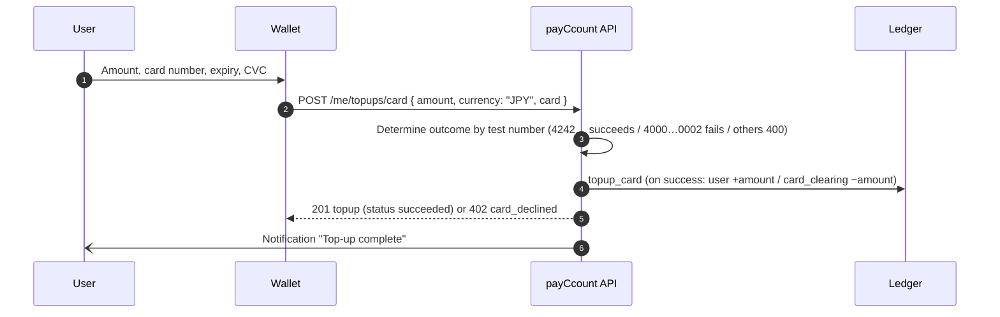
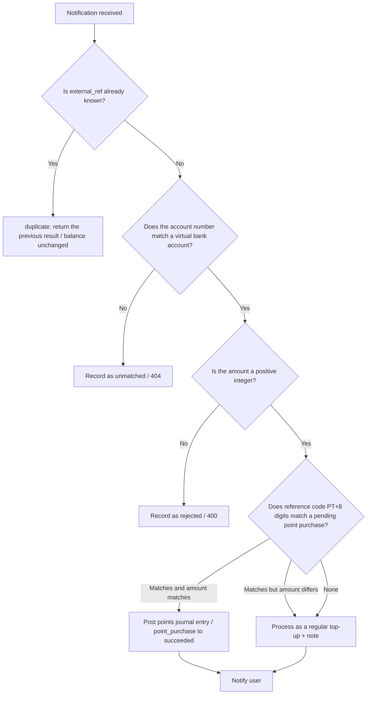
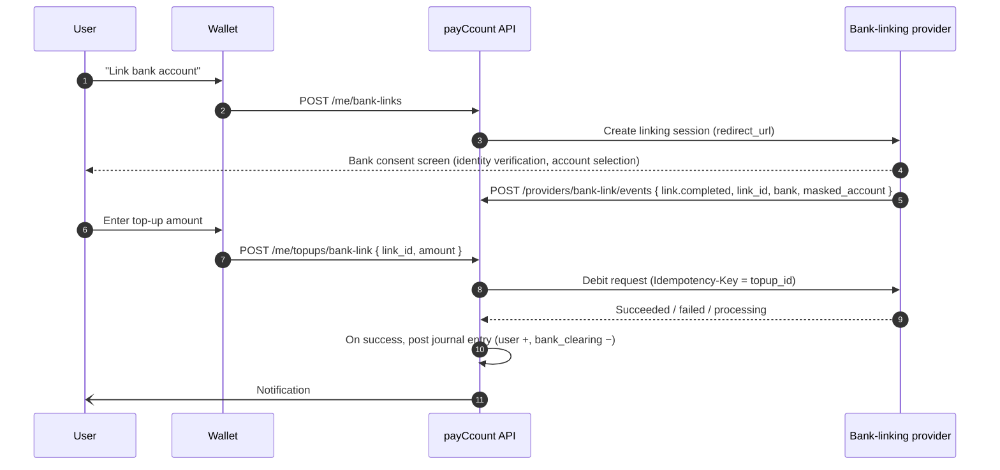

<!-- English version of docs/specs/provider.ja.md — keep both files in sync -->
# payCcount Top-up Integration Specification (for Payment Service Providers and Financial Institutions)

| Item | Details |
|---|---|
| Audience | Integration engineers at **payment service providers (PSPs) and financial institutions** that handle wallet balance top-ups for payCcount. Covered methods: credit card / bank transfer (virtual bank account) / bank account linking (direct debit) |
| Version | 1.0 (2026-09-12) |
| Premise | payCcount is a **demo application** and does not handle real funds or card data. This document describes both the endpoints already implemented in the demo and the specification required for a production integration, and states the status of each explicitly |

**Legend**

| Symbol | Meaning |
|---|---|
| ✅ Implemented | Working in the demo environment (external connections are mocked) |
| 🧭 Production specification | Requirements and proposed interfaces for a production integration. Not implemented in code |

---

## 1. Purpose and scope

payCcount users top up the JPY balance of their wallet and pay merchants from that balance. Because the funds for a top-up come from an external payment method, integrations with payment service providers and financial institutions are required. This document defines the flow of funds, the processing on the payCcount side, and the integration interface for the following three methods.

| Method | Use | Implementation status | Receiving account (clearing account) |
|---|---|---|---|
| A. Credit card | JPY balance top-up, point purchase | ✅ Mock (outcome determined by test numbers) | `card_clearing` |
| B. Bank transfer (virtual bank account) | JPY balance top-up, point purchase (with reference code) | ✅ Mock (deposit notification API provided) | `bank_clearing` |
| C. Bank account linking (direct debit / instant debit) | JPY balance top-up | 🧭 Specification only | `bank_clearing` |

Out of scope: payouts of sales proceeds to merchants, crypto deposits and withdrawals (mocked separately), and exchange rate feeds.

## 2. Funds and the ledger

All payCcount balances are managed in a double-entry ledger; balance tables are never updated directly. Incoming funds from external parties are recorded as journal entries with a **clearing account** as the counterparty account.

| Account | Meaning | Sign of balance |
|---|---|---|
| User account (JPY) | The balance the user can spend | Positive |
| `card_clearing` | **Receivable** from the card company. Decreases when a top-up succeeds and is restored when the card company pays in (settlement) | Normally negative |
| `bank_clearing` | **Funds held** for transfers that have actually arrived at the bank | Normally negative |
| `points_issuer` | The points issuer. When points are bought by card / bank transfer, it receives JPY and issues PT | JPY positive / PT negative |

Example journal entries (all amounts in the smallest unit of JPY = yen):

| Operation | Lines |
|---|---|
| Card top-up ¥30,000 | User JPY **+30,000** / `card_clearing` JPY **−30,000** |
| Bank transfer ¥3,000 | User JPY **+3,000** / `bank_clearing` JPY **−3,000** |
| Point purchase by bank transfer ¥10,000 (+3%) | `bank_clearing` JPY −10,000 / `points_issuer` JPY +10,000 / `points_issuer` PT −10,300 / user PT +10,300 |

The balances of the clearing accounts are expected to be **reconciled daily** against the settlement payments received from the PSP (card) and the actual balance of the bank account (transfers) (§8). Ledger integrity (per-currency total of all journal entries = 0, user accounts ≥ 0, balances agree with the ledger line totals) can be verified at any time from the admin console.

## 3. Common specification

| Item | Specification |
|---|---|
| Currency | Top-ups are **JPY only**. Amounts are integers in yen (as strings) |
| Amount range | Card: ¥100 to ¥1,000,000 per transaction. Bank transfer: any integer of 1 yen or more |
| Idempotency | Notifications from external parties are **idempotent by reference number (`external_ref`)**. From the second time onward, the same reference number returns the same result as `duplicate` and the balance is not increased |
| Timestamps | ISO 8601 (UTC) |
| Error format | `{ "error": { "type", "code", "message", "param" } }` |
| Notification records | Every received notification is recorded in `bank_deposit_notifications` regardless of outcome (`processed` / `duplicate` / `unmatched` / `rejected`) |
| User notifications | An in-app notification (`topup_card` / `topup_bank` / `points_purchase`) is generated when a top-up succeeds |
| 🧭 Signatures | In production, notifications from external parties must carry an HMAC-SHA256 signature (the same scheme as `X-payCcount-Signature: t=…,v1=…`) or use IP restriction plus Basic authentication |
| 🧭 Retries | In production, the sender of a notification must retry on any non-2xx response. Because payCcount is idempotent, duplicates are safe |

## 4. A. Credit card

### 4.1 Current flow (✅ mock)



| Item | Specification |
|---|---|
| Endpoint | `POST /me/topups/card` (user JWT). For point purchases, `POST /me/points/purchase { method: "card" }` |
| Input | `amount` (¥100 to ¥1,000,000), `card.number` (13 to 19 digits), `card.exp` (MM/YY; an expired card returns `400 card_expired`), `card.cvc` (3 to 4 digits), `card.name` (optional) |
| Decision | `4242424242424242` → success, `4000000000000002` → failure (`402 card_declined`; the failure is recorded in the history), anything else → `400 invalid_test_card` |
| Idempotency | `Idempotency-Key` header (per user). The same key returns the same topup |
| Records | `topups` (`method = card`, `status`, `provider_ref`, `card_brand`, `card_last4`, `failure_reason`). **The full card number and the CVC are never stored** |
| Journal entry | Only on success: `topup_card` (user +, `card_clearing` −) |

### 4.2 Requirements for a production integration (🧭)

| Item | Requirement |
|---|---|
| Card data | Card numbers and CVCs never pass through payCcount's servers. Obtain a token through **PSP tokenization** (JS / iframe); payCcount handles only the token |
| Authorization and capture | Because a top-up is credited to the balance immediately, **authorize and capture in a single step**. Split or deferred capture is not used |
| Cardholder authentication | 3-D Secure 2 is performed on the PSP side and the result is included in the response |
| Response | A synchronous response (success / failure / authentication required) is the default; if finalization is asynchronous, it is finalized by a PSP → payCcount notification (§4.3). Until finalized, `topups.status = pending` |
| Idempotency | Requests from payCcount to the PSP pass `topup_id` as the idempotency key. A retry must not result in a double capture |
| Cancellation / refund | Top-up cancellation (taking the amount back out of the balance) is **not supported**. If it is supported in the future, allow it only when the user's balance is at least the cancellation amount, and post a journal entry that restores `card_clearing` |
| Chargebacks | Not supported. When one occurs, the operator handles it with an adjustment journal entry (`adjustment`) |
| Settlement | Payments received from the PSP are treated as clearing `card_clearing` (§8) |
| Records | The PSP's transaction ID is stored in `topups.provider_ref` |

### 4.3 Proposed interface (🧭)

**payCcount → PSP (charge request)**

```
POST {PSP}/charges
Idempotency-Key: <topup_id>
{ "amount": 30000, "currency": "JPY", "token": "<card token>", "capture": true,
  "three_d_secure": "required", "metadata": { "topup_id": "…", "user_id": "…" } }
→ { "id": "<psp charge id>", "status": "succeeded" | "failed" | "pending", "brand": "visa", "last4": "4242", "failure_reason": null }
```

**PSP → payCcount (asynchronous finalization / reversal notification)**

```
POST {API_URL}/providers/card/events
X-payCcount-Signature: t=…,v1=…
{ "id": "<event id>", "type": "charge.succeeded" | "charge.failed" | "charge.reversed",
  "charge_id": "<psp charge id>", "topup_id": "…", "amount": 30000, "currency": "JPY", "occurred_at": "…" }
→ 200 { "received": true, "status": "processed" | "duplicate" }
```

Events are processed idempotently by `topup_id` and `charge_id`: `charge.succeeded` posts the journal entry, `charge.failed` finalizes the failure, and `charge.reversed` notifies the operator for manual handling.

## 5. B. Bank transfer (virtual bank account)

### 5.1 Issuing the virtual bank account (✅)

One mock virtual bank account is issued per user. `POST /me/topups/bank/virtual-account` (returns the existing account if one has already been issued).

| Item | Value (demo) | 🧭 Production |
|---|---|---|
| Bank name / bank code | payCcount Demo Bank (mock) / `9999` | Assigned by the financial institution |
| Branch name / branch code | Demo Branch / `001` | Same as above |
| Account type | Ordinary (savings) | Same as above |
| Account number | 7 digits (randomly assigned, unique across users) | Issued through the financial institution's virtual account API and stored in `account_number` |
| Account holder name | The user's display name (`ﾕｰｻﾞｰ`, half-width katakana for "user", if none) | Follows the financial institution's specification (katakana) |

### 5.2 Receiving deposit notifications (✅ mock → 🧭 production)

In the demo, this is `POST /mock/bank/deposit` (enabled only when `DEMO_MOCK_ENDPOINTS=true`, no authentication). In production, the same processing is expected to be exposed as `POST /providers/bank/deposits` (signature required). The processing itself is the database function `process_bank_deposit`, shared by both.

**Request**

```json
{
  "account_number": "5167127",          // or "virtual_account_id": "<uuid>"
  "amount": "3000",                     // yen, integer, string
  "payer_name": "YAMADA TARO",          // optional
  "external_ref": "BK-20260912-000123", // the bank's deposit reference number (idempotency key). Assigned by payCcount if omitted
  "reference": "PT1A2B3C4D"             // optional. Transfer reference code for a point purchase
}
```

**Processing order (the same as deposit reconciliation in real-world banking operations)**



| Item | Specification |
|---|---|
| Idempotency | If `external_ref` already exists, the previous `topup` / `point_purchase` is returned with `status: duplicate` (HTTP 200) |
| Matching | `account_number` is matched against the virtual bank accounts (`virtual_bank_accounts`) by exact match. A mismatch is recorded as `unmatched` and returns `404 virtual_account_not_found` |
| Amount | If it is not a positive integer, `rejected` (`400 deposit_rejected`, with the reason in `reject_reason`) |
| Reference code | Taken from `reference`; if absent, extracted from `payer_name` with the regular expression `PT[0-9A-F]{8}`. If it matches a `pending` point purchase of that user **and the amount also matches**, points are granted. If the amount differs, the deposit is processed as a regular top-up and the reason is left in `note` |
| Regular top-up | Creates `topups` (`method = bank_transfer`, `status = succeeded`, `provider_ref = external_ref`) and posts the journal entry `topup_bank` (user +, `bank_clearing` −) |
| Notification | "Deposit confirmed" (入金を確認しました; with the amount, payer name, and note) or "Transfer confirmed, points granted" (振込を確認し、ポイントを付与しました) |
| Response | `201 { status: "processed", notification, topup | null, point_purchase | null, note? }` |

**Example response (regular top-up)**

```json
{ "status": "processed",
  "notification": { "id": "…", "account_number": "5167127", "amount": "3000", "payer_name": "YAMADA TARO",
                    "external_ref": "BK-20260912-000123", "status": "processed", "received_at": "…", "processed_at": "…" },
  "topup": { "id": "…", "method": "bank_transfer", "amount": "3000", "currency": "JPY", "status": "succeeded", "provider_ref": "BK-20260912-000123" },
  "point_purchase": null }
```

### 5.3 Reference code for point purchases (bank transfer) (✅)

`POST /me/points/purchase { method: "bank_transfer", amount_jpy }` places the purchase in `pending` and issues a reference code consisting of `PT` followed by 8 hexadecimal digits (for example `PT1A2B3C4D`). The user makes the transfer with **this code prepended to the payer name**. If the amount matches when the deposit notification is reconciled, points (including any campaign bonus) are granted.

### 5.4 Requirements for a production integration (🧭)

| Item | Requirement |
|---|---|
| Authentication | Deposit notifications must be signed (HMAC-SHA256, `t` tolerance 300 seconds) or restricted by source IP plus authentication. The unauthenticated mock endpoint is disabled in production (`DEMO_MOCK_ENDPOINTS=false`) |
| Reference number | `external_ref` becomes **required** (the bank's deposit ID; idempotency key) |
| Retries | The bank retries on any non-2xx response. `unmatched` / `rejected` return 4xx but are already recorded, so a retry does not create a duplicate record (the same `external_ref` yields `duplicate`) |
| Unmatched deposits | The operator reviews them in the admin console and either links them to a user manually or returns the funds. No automatic refunds are made |
| Account issuance | Issued through the financial institution's virtual account API and stored in `virtual_bank_accounts.account_number`. The holder name follows the institution's specification (katakana, character limits) |
| Reversal | Not supported. In the future, add a `reversed` status to `topups` and a journal entry that restores `bank_clearing` |
| Fees | Transfer fees are borne by the payer. payCcount credits the amount received to the balance as is |

## 6. C. Bank account linking (direct debit / instant debit) (🧭 specification only)

In this method the user links their own bank account to payCcount, and each top-up is debited from that account instantly. It is not implemented in the demo; this section defines the requirements for selecting a provider.

### 6.1 Expected flow



### 6.2 Requirements

| Item | Requirement |
|---|---|
| Linking | Use the provider's redirect-based consent flow. payCcount does not hold the account number; it stores only the **link ID and masked account information** |
| Debit | Instant (synchronous) debit by default; if asynchronous, `pending` → finalized by notification. Limits must be configurable per user and per day |
| Idempotency | Debit requests use `topup_id` as the idempotency key |
| Unlinking | The user can unlink at any time. Debit requests after unlinking are rejected |
| Ledger | On success, posted as `topup_bank` (`method = bank_link`). The clearing account is `bank_clearing` |
| Failures | Error codes that distinguish insufficient funds, limit exceeded, and invalid link (`insufficient_bank_funds` / `limit_exceeded` / `link_invalid`) |
| Proposed data items | `bank_links(id, user_id, provider, provider_link_id, bank_name, masked_account, status linked/revoked, created_at, revoked_at)`, and add `bank_link` to `topups.method` |

## 7. Notifications (in-app)

Top-up results are recorded as in-app notifications for the user and shown under the wallet's bell icon.

| type | Trigger | data |
|---|---|---|
| `topup_card` | Card top-up succeeded | `topup_id`, `amount`, `currency` |
| `topup_bank` | Bank transfer credited to the balance | `topup_id`, `amount`, `currency`, `payer_name` |
| `points_purchase` | Points granted (card / bank transfer / balance) | `purchase_id`, `points`, `bonus` or `external_ref` |

## 8. Settlement and reconciliation (operations)

| Target | Reconciliation approach |
|---|---|
| `card_clearing` | Reconcile the total amount of successful top-ups during the period (= the decrease in the account) against the settlement amount received from the PSP. Differences are handled as PSP fees or chargebacks with adjustment journal entries (`adjustment`) |
| `bank_clearing` | Reconcile the decrease in the account against the actual balance of the virtual bank accounts (funds received). Review unmatched deposits (`unmatched`) and rejections (`rejected`) in the deposit notification history in the admin console |
| Ledger verification | Use the admin console's "Ledger" page or `pnpm ledger:verify` to confirm that all journal entries sum to 0, user accounts are non-negative, and balances agree with the ledger line totals |

## 9. Testing (demo environment)

| Step | How |
|---|---|
| Card top-up | Wallet "Top up" → Card → test number. Or `POST /me/topups/card` |
| Issue a virtual bank account | Wallet "Top up" → Bank transfer. Or `POST /me/topups/bank/virtual-account` |
| Generate a deposit notification | The "Send deposit notification" button on the screen, or the cURL below |
| Point purchase (bank transfer) | Wallet "Points" → Bank transfer → "Simulate a deposit" from the pending transfers |

```bash
curl -X POST {{API_URL}}/mock/bank/deposit -H "Content-Type: application/json" \
  -d '{"account_number":"5167127","amount":"3000","payer_name":"YAMADA TARO","external_ref":"TEST-0001"}'
# The second call returns duplicate (HTTP 200) and the balance is not increased
```

## 10. Appendix: Data items

**`topups`**: `id`, `user_id`, `method` (`card` / `bank_transfer`), `currency` (JPY), `amount`, `status` (`pending` / `succeeded` / `failed`), `provider_ref`, `failure_reason`, `card_brand`, `card_last4`, `journal_id`, `created_at`

**`virtual_bank_accounts`**: `id`, `user_id` (one per user), `bank_name`, `bank_code`, `branch_name`, `branch_code`, `account_type`, `account_number` (unique), `holder_name`, `created_at`

**`bank_deposit_notifications`**: `id`, `virtual_account_id`, `account_number`, `amount`, `currency`, `payer_name`, `external_ref` (unique), `status` (`processed` / `unmatched` / `duplicate` / `rejected`), `reject_reason`, `received_at`, `processed_at`, `topup_id`, `point_purchase_id`

**`point_purchases`**: `id`, `user_id`, `paid_amount`, `points_granted`, `bonus_points`, `payment_method` (`card` / `bank_transfer` / `wallet_jpy`), `status` (`pending` / `succeeded` / `failed`), `campaign_id`, `transfer_reference` (`PTxxxxxxxx`), `journal_id`, `completed_at`

## 11. Limitations (demo)

- None of the card, bank transfer, or direct debit methods connects to an external system. Card success or failure is determined by fixed test numbers.
- The deposit notification endpoint is an unauthenticated mock and must not be used as is in production (§5.4).
- Top-up cancellation, reversal, and chargebacks are not supported.
- Top-ups are JPY only. Foreign currency and crypto top-ups are handled by separate features (exchange, crypto).

## Appendix: Revision history

| Version | Date | Details |
|---|---|---|
| 1.0 | 2026-09-12 | Initial version. A / B documented based on the implementation (mock); C specification only |
