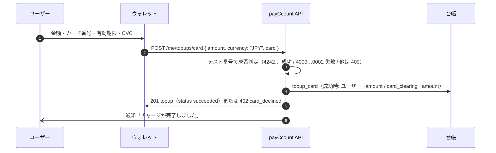
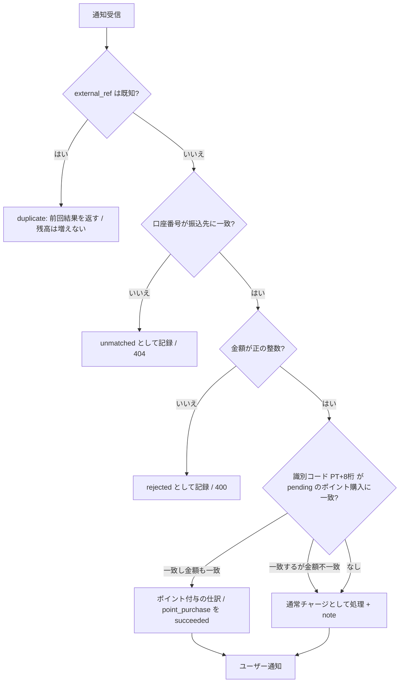
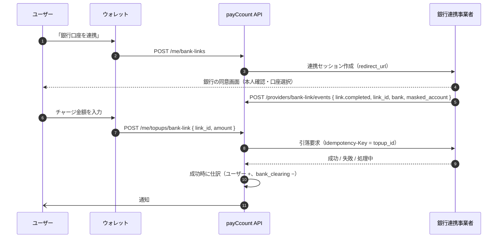

# payCcount チャージ接続仕様書（決済代行会社・金融機関向け）

| 項目 | 内容 |
|---|---|
| 対象読者 | payCcount のウォレット残高チャージを担う **決済代行会社（PSP）・金融機関** の接続担当者。対象手段は クレジットカード / 銀行振込（バーチャル口座） / 銀行連携（口座振替） |
| 版 | 1.0（2026-09-12） |
| 前提 | payCcount は**デモアプリケーション**であり、実際の資金・カード情報は扱わない。本書は、デモで実装済みの受け口と、本番接続時に必要となる仕様の両方を記載し、状態を明示する |

**凡例**

| 記号 | 意味 |
|---|---|
| ✅ 実装済み | デモ環境で動作している（外部接続はモック） |
| 🧭 本番仕様 | 本番接続時の要件・インターフェース案。コードは未実装 |

---

## 1. 目的と範囲

payCcount のユーザーは、ウォレットの JPY 残高をチャージし、その残高で加盟店に支払う。チャージの原資は外部の決済手段から入るため、決済代行会社・金融機関との接続が必要になる。本書は次の 3 手段について、資金の流れ・payCcount 側の処理・接続インターフェースを定める。

| 手段 | 用途 | 実装状況 | 資金の受け口（清算勘定） |
|---|---|---|---|
| A. クレジットカード | JPY 残高チャージ、ポイント購入 | ✅ モック（テスト番号で成否判定） | `card_clearing` |
| B. 銀行振込（バーチャル口座） | JPY 残高チャージ、ポイント購入（識別コード付き） | ✅ モック（入金通知 API を用意） | `bank_clearing` |
| C. 銀行連携（口座振替 / 即時引落） | JPY 残高チャージ | 🧭 仕様のみ | `bank_clearing` |

範囲外: 加盟店への売上出金（payout）、暗号資産の入出金（別途モック）、為替レートの供給。

## 2. 資金と台帳の考え方

payCcount の残高はすべて複式簿記の台帳で管理され、残高テーブルを直接更新することはない。外部からの入金は「**清算勘定**」を相手勘定として仕訳される。

| 勘定 | 意味 | 残高の符号 |
|---|---|---|
| ユーザー口座（JPY） | ユーザーが使える残高 | 正 |
| `card_clearing` | カード会社からの**未収金**。チャージ成功時に減り、カード会社からの入金（精算）で戻る | 通常は負 |
| `bank_clearing` | 銀行に実際に着金した振込の**預り金** | 通常は負 |
| `points_issuer` | ポイント発行元。カード / 振込でポイントを買うと JPY を受け取り PT を発行 | JPY 正 / PT 負 |

仕訳例（金額はすべて JPY の最小単位 = 円）:

| 操作 | 行 |
|---|---|
| カードチャージ ¥30,000 | ユーザー JPY **+30,000** / `card_clearing` JPY **−30,000** |
| 銀行振込 ¥3,000 | ユーザー JPY **+3,000** / `bank_clearing` JPY **−3,000** |
| 銀行振込でポイント購入 ¥10,000（+3%） | `bank_clearing` JPY −10,000 / `points_issuer` JPY +10,000 / `points_issuer` PT −10,300 / ユーザー PT +10,300 |

清算勘定の残高は、決済代行会社からの精算入金（カード）や銀行口座の実残高（振込）と**日次で突合**されることを想定する（§8）。台帳の整合性（全仕訳の通貨別合計 = 0、ユーザー口座 ≥ 0、残高と仕訳集計の一致）は運営画面で常時検証できる。

## 3. 共通仕様

| 項目 | 仕様 |
|---|---|
| 通貨 | チャージは **JPY のみ**。金額は円単位の整数（文字列） |
| 金額範囲 | カード: ¥100 〜 ¥1,000,000 / 回。銀行振込: 1 円以上の整数 |
| 冪等性 | 外部からの通知は**参照番号（`external_ref`）で冪等**。同じ参照番号は 2 回目以降 `duplicate` として同じ結果を返し、残高は増えない |
| 時刻 | ISO 8601（UTC） |
| エラー形式 | `{ "error": { "type", "code", "message", "param" } }` |
| 通知の記録 | 受信した通知は結果にかかわらず `bank_deposit_notifications` に記録される（`processed` / `duplicate` / `unmatched` / `rejected`） |
| ユーザー通知 | チャージ成功時にアプリ内通知（`topup_card` / `topup_bank` / `points_purchase`）を生成 |
| 🧭 署名 | 本番では外部からの通知に HMAC-SHA256 署名（`X-payCcount-Signature: t=…,v1=…` と同方式）または IP 制限 + Basic 認証を必須とする |
| 🧭 再送 | 本番では通知の送信側が 2xx 以外で再送すること。payCcount 側は冪等なので重複は安全 |

## 4. A. クレジットカード

### 4.1 現行フロー（✅ モック）



| 項目 | 仕様 |
|---|---|
| エンドポイント | `POST /me/topups/card`（ユーザー JWT）。ポイント購入は `POST /me/points/purchase { method: "card" }` |
| 入力 | `amount`（¥100〜¥1,000,000）、`card.number`（13〜19 桁）、`card.exp`（MM/YY、期限切れは `400 card_expired`）、`card.cvc`（3〜4 桁）、`card.name`（任意） |
| 判定 | `4242424242424242` → 成功、`4000000000000002` → 失敗（`402 card_declined`、失敗履歴を記録）、それ以外 → `400 invalid_test_card` |
| 冪等 | `Idempotency-Key` ヘッダー（ユーザー単位）。同じキーは同じ topup を返す |
| 記録 | `topups`（`method = card`, `status`, `provider_ref`, `card_brand`, `card_last4`, `failure_reason`）。**カード番号本体・CVC は保存しない** |
| 仕訳 | 成功時のみ `topup_card`（ユーザー +、`card_clearing` −） |

### 4.2 本番接続時の要件（🧭）

| 項目 | 要件 |
|---|---|
| カード情報 | payCcount のサーバーにカード番号・CVC を通さない。**PSP のトークン化**（JS / iframe）でトークンを取得し、payCcount はトークンのみを扱う |
| 与信と売上 | チャージは即時に残高化するため、**オーソリと売上確定（capture）を同時**に行う。分割・後日売上は使わない |
| 本人認証 | 3-D Secure 2 を PSP 側で実施し、結果を応答に含める |
| 応答 | 同期応答（成功 / 失敗 / 要認証）を基本とし、非同期確定の場合は PSP → payCcount の通知（§4.3）で確定する。確定まで `topups.status = pending` |
| 冪等 | payCcount → PSP の要求に `topup_id` を冪等キーとして渡す。再送で二重売上にならないこと |
| 取消 / 返金 | チャージ取消（残高から戻す）は**未対応**。将来対応する場合は、ユーザー残高が取消額以上あるときのみ許可し、`card_clearing` を戻す仕訳を切る |
| チャージバック | 未対応。発生時は運営が調整仕訳（`adjustment`）で処理する |
| 精算 | PSP からの入金は `card_clearing` の消込として扱う（§8） |
| 記録 | PSP の取引 ID を `topups.provider_ref` に保存する |

### 4.3 インターフェース案（🧭）

**payCcount → PSP（売上要求）**

```
POST {PSP}/charges
Idempotency-Key: <topup_id>
{ "amount": 30000, "currency": "JPY", "token": "<card token>", "capture": true,
  "three_d_secure": "required", "metadata": { "topup_id": "…", "user_id": "…" } }
→ { "id": "<psp charge id>", "status": "succeeded" | "failed" | "pending", "brand": "visa", "last4": "4242", "failure_reason": null }
```

**PSP → payCcount（非同期確定 / 取消通知）**

```
POST {API_URL}/providers/card/events
X-payCcount-Signature: t=…,v1=…
{ "id": "<event id>", "type": "charge.succeeded" | "charge.failed" | "charge.reversed",
  "charge_id": "<psp charge id>", "topup_id": "…", "amount": 30000, "currency": "JPY", "occurred_at": "…" }
→ 200 { "received": true, "status": "processed" | "duplicate" }
```

`topup_id` と `charge_id` で冪等に処理し、`charge.succeeded` で仕訳、`charge.failed` で失敗確定、`charge.reversed` は運営に通知して手動対応とする。

## 5. B. 銀行振込（バーチャル口座）

### 5.1 振込先の発行（✅）

ユーザーごとに 1 つの模擬振込先を発行する。`POST /me/topups/bank/virtual-account`（既にあれば同じものを返す）。

| 項目 | 値（デモ） | 🧭 本番 |
|---|---|---|
| 銀行名 / 銀行コード | payCcountデモ銀行 / `9999` | 金融機関が付与 |
| 支店名 / 支店コード | デモ支店 / `001` | 同上 |
| 口座種別 | 普通 | 同上 |
| 口座番号 | 7 桁（ランダム採番、ユーザー間で一意） | 金融機関のバーチャル口座 API で発行し、`account_number` に保存 |
| 名義 | ユーザーの表示名（無ければ `ﾕｰｻﾞｰ`） | 金融機関の仕様（カナ）に合わせる |

### 5.2 入金通知の受信（✅ モック → 🧭 本番）

デモでは `POST /mock/bank/deposit`（`DEMO_MOCK_ENDPOINTS=true` のときのみ有効、認証なし）。本番では同じ処理を `POST /providers/bank/deposits`（署名必須）として公開する想定。処理本体は DB の `process_bank_deposit` で、両者で共通。

**リクエスト**

```json
{
  "account_number": "5167127",          // または "virtual_account_id": "<uuid>"
  "amount": "3000",                     // 円、整数、文字列
  "payer_name": "ヤマダ タロウ",          // 任意
  "external_ref": "BK-20260912-000123", // 銀行側の入金参照番号（冪等キー）。省略時は payCcount が採番
  "reference": "PT1A2B3C4D"             // 任意。ポイント購入の振込識別コード
}
```

**処理順序（実務の入金消込と同じ）**



| 項目 | 仕様 |
|---|---|
| 冪等 | `external_ref` が既存なら `status: duplicate`（HTTP 200）で前回の `topup` / `point_purchase` を返す |
| 照合 | `account_number` を振込先（`virtual_bank_accounts`）と完全一致で照合。不一致は `unmatched` として記録し `404 virtual_account_not_found` |
| 金額 | 正の整数でなければ `rejected`（`400 deposit_rejected`、`reject_reason` に理由） |
| 識別コード | `reference`、無ければ `payer_name` から正規表現 `PT[0-9A-F]{8}` を抽出。該当ユーザーの `pending` なポイント購入と一致し**金額も一致**すればポイントを付与。金額不一致なら通常チャージにし `note` に理由を残す |
| 通常チャージ | `topups`（`method = bank_transfer`, `status = succeeded`, `provider_ref = external_ref`）を作成し、仕訳 `topup_bank`（ユーザー +、`bank_clearing` −） |
| 通知 | 「入金を確認しました」（金額・振込人名・note）または「振込を確認し、ポイントを付与しました」 |
| レスポンス | `201 { status: "processed", notification, topup | null, point_purchase | null, note? }` |

**レスポンス例（通常チャージ）**

```json
{ "status": "processed",
  "notification": { "id": "…", "account_number": "5167127", "amount": "3000", "payer_name": "ヤマダ タロウ",
                    "external_ref": "BK-20260912-000123", "status": "processed", "received_at": "…", "processed_at": "…" },
  "topup": { "id": "…", "method": "bank_transfer", "amount": "3000", "currency": "JPY", "status": "succeeded", "provider_ref": "BK-20260912-000123" },
  "point_purchase": null }
```

### 5.3 ポイント購入（振込）の識別コード（✅）

`POST /me/points/purchase { method: "bank_transfer", amount_jpy }` で購入を `pending` にし、識別コード `PT` + 8 桁の 16 進数（例 `PT1A2B3C4D`）を発行する。ユーザーは**振込人名の先頭にこのコード**を付けて振り込む。入金通知の照合で金額が一致すればポイント（キャンペーンのボーナス込み）を付与する。

### 5.4 本番接続時の要件（🧭）

| 項目 | 要件 |
|---|---|
| 認証 | 入金通知に署名（HMAC-SHA256、`t` の許容ずれ 300 秒）または送信元 IP 制限 + 認証を必須とする。モックの無認証エンドポイントは本番で無効化する（`DEMO_MOCK_ENDPOINTS=false`） |
| 参照番号 | `external_ref` を**必須**にする（銀行側の入金 ID。冪等キー） |
| 再送 | 銀行側は 2xx 以外で再送する。`unmatched` / `rejected` は 4xx を返すが記録済みなので、再送されても重複記録にはならない（同じ `external_ref` は `duplicate`） |
| 未照合入金 | 運営が管理画面で確認し、手動でユーザーに紐付けるか組戻す。自動返金は行わない |
| 口座の発行 | 金融機関のバーチャル口座 API で発行し、`virtual_bank_accounts.account_number` に保存。名義は金融機関の仕様（カナ・文字数）に合わせる |
| 組戻し | 未対応。将来は `topups` に `reversed` 状態と `bank_clearing` を戻す仕訳を追加 |
| 手数料 | 振込手数料は振込人負担。payCcount は受取額をそのまま残高化する |

## 6. C. 銀行連携（口座振替 / 即時引落）（🧭 仕様のみ）

ユーザーが自分の銀行口座を payCcount に連携し、チャージ時に口座から即時に引き落とす方式。デモでは未実装であり、本節は接続先を選定する際の要件定義である。

### 6.1 想定フロー



### 6.2 要件

| 項目 | 要件 |
|---|---|
| 連携 | 事業者のリダイレクト型同意フローを使う。payCcount は口座番号を保持せず、**連携 ID とマスク済み口座情報**のみ保存する |
| 引落 | 即時引落（同期）を基本とし、非同期の場合は `pending` → 通知で確定。上限額はユーザーごと・日次で設定できること |
| 冪等 | 引落要求は `topup_id` を冪等キーにする |
| 解除 | ユーザーがいつでも連携解除できる。解除後の引落要求は拒否 |
| 台帳 | 成功時に `topup_bank`（`method = bank_link`）として仕訳。清算勘定は `bank_clearing` |
| 失敗 | 残高不足・上限超過・連携無効を区別できるエラーコード（`insufficient_bank_funds` / `limit_exceeded` / `link_invalid`） |
| データ項目案 | `bank_links(id, user_id, provider, provider_link_id, bank_name, masked_account, status linked/revoked, created_at, revoked_at)`、`topups.method` に `bank_link` を追加 |

## 7. 通知（アプリ内）

チャージ結果はユーザーのアプリ内通知として記録され、ウォレットのベルに表示される。

| type | 発生 | data |
|---|---|---|
| `topup_card` | カードチャージ成功 | `topup_id`, `amount`, `currency` |
| `topup_bank` | 振込の残高反映 | `topup_id`, `amount`, `currency`, `payer_name` |
| `points_purchase` | ポイント付与（カード / 振込 / 残高） | `purchase_id`, `points`, `bonus` または `external_ref` |

## 8. 精算と突合（運用）

| 対象 | 突合の考え方 |
|---|---|
| `card_clearing` | 期間中のチャージ成功額の合計（= 勘定の減少額）と PSP からの精算入金額を突合。差額は PSP 手数料・チャージバックとして調整仕訳（`adjustment`）で処理 |
| `bank_clearing` | 勘定の減少額とバーチャル口座の実残高（着金額）を突合。未照合入金（`unmatched`）と拒否（`rejected`）は管理画面の入金通知履歴で確認 |
| 台帳検証 | 管理画面「台帳」または `pnpm ledger:verify` で、全仕訳合計 0・ユーザー口座非負・残高と仕訳集計の一致を確認 |

## 9. テスト（デモ環境）

| 手順 | 方法 |
|---|---|
| カードチャージ | ウォレット「チャージ」→ カード → テスト番号。または `POST /me/topups/card` |
| 振込先の発行 | ウォレット「チャージ」→ 銀行振込。または `POST /me/topups/bank/virtual-account` |
| 入金通知の発生 | 画面の「入金通知を発生させる」ボタン、または下記 cURL |
| ポイント購入（振込） | ウォレット「ポイント」→ 銀行振込 → 保留中の振込から「入金をシミュレート」 |

```bash
curl -X POST {{API_URL}}/mock/bank/deposit -H "Content-Type: application/json" \
  -d '{"account_number":"5167127","amount":"3000","payer_name":"ヤマダ タロウ","external_ref":"TEST-0001"}'
# 2 回目は duplicate（HTTP 200）で残高は増えない
```

## 10. 付録: データ項目

**`topups`**: `id`, `user_id`, `method`（`card` / `bank_transfer`）, `currency`（JPY）, `amount`, `status`（`pending` / `succeeded` / `failed`）, `provider_ref`, `failure_reason`, `card_brand`, `card_last4`, `journal_id`, `created_at`

**`virtual_bank_accounts`**: `id`, `user_id`（ユーザーごとに 1 件）, `bank_name`, `bank_code`, `branch_name`, `branch_code`, `account_type`, `account_number`（一意）, `holder_name`, `created_at`

**`bank_deposit_notifications`**: `id`, `virtual_account_id`, `account_number`, `amount`, `currency`, `payer_name`, `external_ref`（一意）, `status`（`processed` / `unmatched` / `duplicate` / `rejected`）, `reject_reason`, `received_at`, `processed_at`, `topup_id`, `point_purchase_id`

**`point_purchases`**: `id`, `user_id`, `paid_amount`, `points_granted`, `bonus_points`, `payment_method`（`card` / `bank_transfer` / `wallet_jpy`）, `status`（`pending` / `succeeded` / `failed`）, `campaign_id`, `transfer_reference`（`PTxxxxxxxx`）, `journal_id`, `completed_at`

## 11. 制限事項（デモ）

- カード・銀行・口座振替のいずれも外部システムには接続しない。カードは固定のテスト番号で成否を決める。
- 入金通知の受け口は無認証のモックであり、本番ではそのまま使わない（§5.4）。
- チャージの取消・組戻し・チャージバックは未対応。
- チャージは JPY のみ。外貨・暗号資産のチャージは別機能（両替・クリプト）で行う。

## 付録 改訂履歴

| 版 | 日付 | 内容 |
|---|---|---|
| 1.0 | 2026-09-12 | 初版。A / B は実装（モック）に基づき記載、C は仕様のみ |
